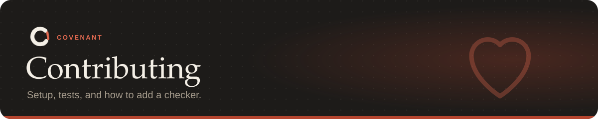

<p align="center"></p>

Bug reports, new checkers, benchmark tasks and fixes are all welcome. Thanks for helping.

**On this page:** [Set up](#set-up) · [Where things are](#where-things-are) ·
[Before opening a pull request](#before-opening-a-pull-request) · [Adding a checker](#adding-a-checker) ·
[Releasing](#releasing)

---

## Set up

Use Python 3.11 or newer and Git. Activate a virtual environment in the repository root
before installing. The development and Anthropic extras match the Python test jobs.

```bash
python -m pip install -e ".[dev,anthropic]"
python -m pytest -q
```

Use Node.js 22 and install the editor's locked dependencies to enable the TypeScript checker
tests. Point `COVENANT_TYPESCRIPT` to the package if Node cannot resolve it by name.

```bash
npm --prefix vscode-extension ci
COVENANT_TYPESCRIPT="$PWD/vscode-extension/node_modules/typescript" python -m pytest -q
```

```powershell
npm --prefix vscode-extension ci
$env:COVENANT_TYPESCRIPT = (Resolve-Path 'vscode-extension/node_modules/typescript').Path
python -m pytest -q
```

## Where things are

| Path | What's there |
|---|---|
| `src/covenant/ir.py` | The rule format ([reference](docs/covenant-yaml.md)) |
| `src/covenant/compiler/` | Instruction → rules: `extract`, `ground`, `bind`, `pipeline` |
| `src/covenant/packs.py` | Rule packs |
| `src/covenant/runtime.py`, `monitors/` | Enforcement: events, the trace, side effects, escalation |
| `src/covenant/verifiers/` | The checkers, registered in `registry.py` |
| `src/covenant/integrations/` | Claude Code hooks and the MCP server |
| `src/covenant/hookclient.py`, `server.py` | Fast hooks: the tiny client and the daemon it talks to |
| `src/covenant/snapshots.py`, `explain.py`, `alerts.py`, `suggest.py` | Undo, explain, alerts, suggest |
| `src/covenant/policy.py` | Team policies |
| `src/covenant/ci.py`, `github.py` | `covenant ci` and PR comments |
| `src/covenant/server.py`, `sandbox.py`, `sandbox_proxy.py` | Hook server and Docker sandbox |
| `src/covenant/testcmd.py`, `status.py`, `validate.py` | What counts as a test run, `covenant status`, `covenant validate` |
| `src/covenant/dashboard.py`, `dashboard.html` | The dashboard |
| `src/covenant/cli.py` | Commands |
| `src/covenant/bench/` | CovenantBench runner, oracles and the history replay |
| `bench/tasks/`, `bench/replay/` | Benchmark tasks; replay repo list and results |
| `examples/mylib` | The worked example |
| `vscode-extension/` | The VS Code extension |
| `docs/` | User guides, references, verification notes and artwork |
| `scripts/verify_distribution.py` | Published and candidate wheel lifecycle smoke checks |
| `.github/workflows/` | CI matrix and release publishing |

## Before opening a pull request

- [ ] Cover behavior changes with tests using the relevant files, Git history or event fixtures.
- [ ] Run the Python suite. For editor changes, also run the extension unit suite and the
      [VS Code integration suite](vscode-extension/README.md#build).
- [ ] For sandbox changes, run the [Docker Compose smoke test](docs/safety.md#docker-verification).
- [ ] If you changed enforcement, run the benchmark and make sure no mode got worse:
      `covenant bench run --mode prompt --mode covenant --mode groundtruth`.
- [ ] If you changed a checker, replay real history and compare the flagged commits:
      `covenant bench replay --only pallets/click,sindresorhus/ky,spf13/cobra`.
- [ ] Keep the README and [docs](docs/README.md) in step with what the code does. Update
      the [compatibility matrix](docs/compatibility.md) when released and source behavior differ.

The [CI workflow](.github/workflows/ci.yml) lists the Ruff, mypy, benchmark and integration
commands used in CI.

## Adding a checker

1. Write it in `src/covenant/verifiers/` and register it in `verifiers/registry.py`.
2. Teach the binder (`compiler/bind.py`) which instructions map to it.
3. Add tests, and ideally a benchmark task in `bench/tasks/` whose naive plan breaks the rule.
4. Document it in [docs/rules.md](docs/rules.md) and its settings in
   [docs/covenant-yaml.md](docs/covenant-yaml.md#checker-settings).

## Releasing

Bump the version in `pyproject.toml`, `src/covenant/__init__.py` and
`vscode-extension/package.json`. Refresh the extension's lockfile and move the Unreleased
notes to a dated [changelog entry](CHANGELOG.md).

Build the wheel and verify it in an isolated environment before tagging. Pass the candidate
wheel by its full filename.

```bash
python -m pip install build
python -m build --wheel
python scripts/verify_distribution.py covenant-agents==0.1.2 --upgrade-from covenant-agents==0.1.1 --candidate dist/covenant_agents-0.1.2-py3-none-any.whl
```

Replace the candidate filename after a version bump.

Push a `v<version>` tag that matches `pyproject.toml`. The
[release workflow](.github/workflows/release.yml) publishes through PyPI Trusted Publishing
in the `pypi` environment, publishes to the Marketplace when `VSCE_PAT` is set, and attaches
the wheel, source distribution and `.vsix` to the GitHub release.

## Reporting security problems

Please don't open a public issue. See [SECURITY.md](SECURITY.md).
