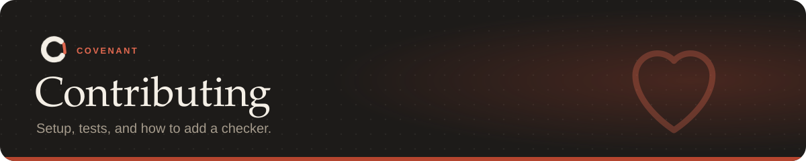

<p align="center"></p>

Bug reports, new checkers, benchmark tasks and fixes are all welcome. Thanks for helping.

**On this page:** [Set up](#set-up) · [Where things are](#where-things-are) ·
[Before opening a pull request](#before-opening-a-pull-request) · [Adding a checker](#adding-a-checker) ·
[Releasing](#releasing)

---

## Set up

```bash
pip install -e ".[dev]"
npm install --prefix /tmp/ts typescript@5.6.3   # for the TypeScript checker tests
COVENANT_TYPESCRIPT=/tmp/ts/node_modules/typescript python -m pytest -q
```

Without `COVENANT_TYPESCRIPT` the TypeScript tests are skipped. The VS Code extension has its
own tests:

```bash
cd vscode-extension
npm install
npm test
```

## Where things are

| Path | What's there |
|---|---|
| `src/covenant/ir.py` | The rule format ([reference](docs/covenant-yaml.md)) |
| `src/covenant/compiler/` | Instruction → rules: `extract`, `ground`, `bind`, `pipeline` |
| `src/covenant/packs.py` | Rule packs |
| `src/covenant/runtime.py`, `monitors/` | Enforcement: events, the trace, side effects, escalation |
| `src/covenant/verifiers/` | The checkers, registered in `registry.py` |
| `src/covenant/integrations/` | Claude Code hooks and the MCP server |
| `src/covenant/hookclient.py`, `server.py` | Fast hooks: the tiny client and the daemon it talks to |
| `src/covenant/snapshots.py`, `explain.py`, `alerts.py`, `suggest.py` | Undo, explain, alerts, suggest |
| `src/covenant/policy.py` | Team policies |
| `src/covenant/ci.py`, `github.py` | `covenant ci` and PR comments |
| `src/covenant/server.py`, `sandbox.py`, `sandbox_proxy.py` | Hook server and Docker sandbox |
| `src/covenant/testcmd.py`, `status.py`, `validate.py` | What counts as a test run, `covenant status`, `covenant validate` |
| `src/covenant/dashboard.py`, `dashboard.html` | The dashboard |
| `src/covenant/cli.py` | Commands |
| `src/covenant/bench/` | CovenantBench runner, oracles and the history replay |
| `bench/tasks/`, `bench/replay/` | Benchmark tasks; replay repo list and results |
| `examples/mylib` | The worked example |
| `vscode-extension/` | The VS Code extension |
| `docs/` | These docs; `docs/assets/` holds the artwork (SVG) |

## Before opening a pull request

- [ ] Add or update tests for what you changed. Every checker is tested against real files and
      git history, not mocks.
- [ ] Run the whole Python suite and, if you touched `vscode-extension/`, `npm test`.
- [ ] If you changed enforcement, run the benchmark and make sure no mode got worse:
      `covenant bench run --mode prompt --mode covenant --mode groundtruth`.
- [ ] If you changed a checker, replay real history and compare the flagged commits:
      `covenant bench replay --only pallets/click,sindresorhus/ky,spf13/cobra`.
- [ ] Keep the README and [docs](docs/README.md) in step with what the code does.

## Adding a checker

1. Write it in `src/covenant/verifiers/` and register it in `verifiers/registry.py`.
2. Teach the binder (`compiler/bind.py`) which instructions map to it.
3. Add tests, and ideally a benchmark task in `bench/tasks/` whose naive plan breaks the rule.
4. Document it in [docs/rules.md](docs/rules.md) and its settings in
   [docs/covenant-yaml.md](docs/covenant-yaml.md#checker-settings).

## Releasing

Bump the version in `pyproject.toml`, `src/covenant/__init__.py` and
`vscode-extension/package.json`, add a `CHANGELOG.md` entry, and push a `v<version>` tag. The
release workflow tests, builds, publishes to PyPI and (when the `VSCE_PAT` secret is set) the VS Code Marketplace, and attaches the
wheel, sdist and `.vsix` to a GitHub release.

## Reporting security problems

Please don't open a public issue. See [SECURITY.md](SECURITY.md).
