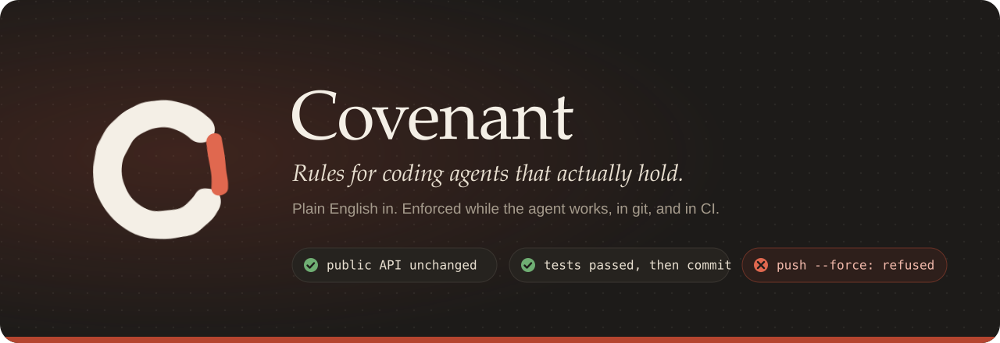
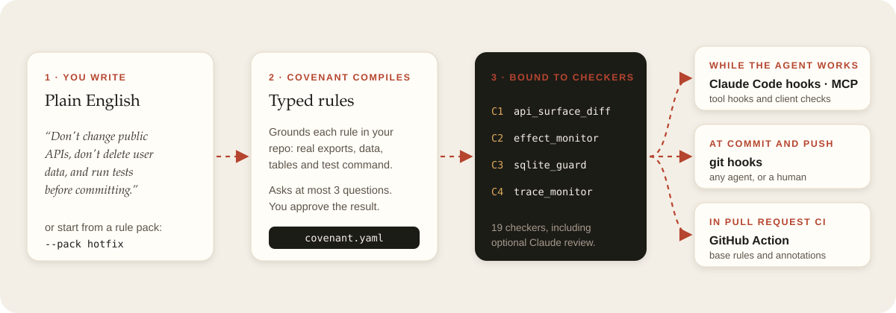
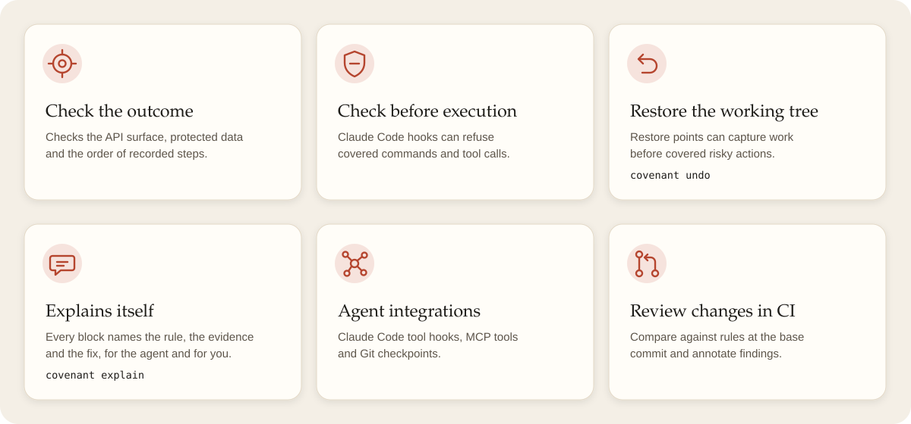
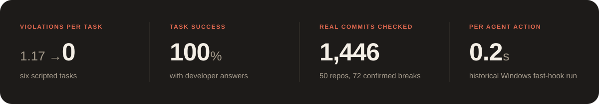
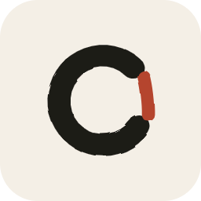

<p align="center">
  
</p>

<p align="center">
  <a href="https://pypi.org/project/covenant-agents/"></a>
  <a href="https://pypi.org/project/covenant-agents/"></a>
  <a href="https://github.com/visweshdev/Covenant/actions/workflows/ci.yml"></a>
  <a href="https://github.com/visweshdev/Covenant/blob/main/LICENSE"></a>
</p>

<p align="center">
  <a href="#quick-start"><b>Quick start</b></a> &nbsp;·&nbsp;
  <a href="#how-it-works"><b>How it works</b></a> &nbsp;·&nbsp;
  <a href="#key-terms"><b>Key terms</b></a> &nbsp;·&nbsp;
  <a href="#what-it-can-enforce"><b>Rules</b></a> &nbsp;·&nbsp;
  <a href="#evaluation"><b>Evaluation</b></a> &nbsp;·&nbsp;
  <a href="https://github.com/visweshdev/Covenant/blob/main/docs/README.md"><b>Docs</b></a> &nbsp;·&nbsp;
  <a href="https://github.com/visweshdev/Covenant/blob/main/CHANGELOG.md"><b>Changelog</b></a>
</p>

<br>

**Covenant is a policy enforcement layer for coding agent harnesses.** It turns plain-English
repository instructions into executable checks. Use it to preserve public APIs, protect data
files, and require a passing test run after the last recorded edit before a commit.

**Harness engineering** is the work of building the environment, checks, and feedback loops
that help agents work reliably. Covenant handles repository policy in that environment. It plugs
into existing coding agents, Git, and CI to check actions and outcomes, then gives the agent
evidence and a way to correct violations. [OpenAI’s overview of harness engineering](https://openai.com/index/harness-engineering/)

<p align="center">
  
</p>

## Quick start

```bash
pipx install covenant-agents        # or: pip install covenant-agents
```

```bash
cd your-repo
covenant compile --offline "Don't change public APIs, don't delete user data, run tests before committing."
covenant init
covenant status
```

Run this in a Git repository with at least one commit. Review the draft before accepting
`covenant.yaml`, especially the inferred API scope, protected paths, and test command.
`covenant init` installs Git and Claude Code hooks and pins the approved rules for the task.
Covenant requires Python 3.11+ and Git and supports Windows, macOS, and Linux. The offline
compiler in this example works without Claude credentials.

**Already have Git hooks?** Use `covenant init --no-git` and integrate Covenant with your
hooks. PyPI 0.1.2 replaces existing default hooks, while the current source refuses to
overwrite them. [Git hook setup](https://github.com/visweshdev/Covenant/blob/main/docs/agents.md#git-hooks)

> Start with a rule pack using `covenant compile --offline --pack hotfix "fix the login crash"`.
> Run `covenant packs` to list the packs or `covenant suggest` to propose rules from the
> repository's history.

## How it works

<p align="center">
  
</p>

1. **Compile.** `covenant compile` maps an instruction to a checker and repository-specific
   settings in `covenant.yaml`. Use the offline compiler or configure a Claude backend.
2. **Approve.** Review the generated clauses, scope, and assumptions. `covenant init` or
   `covenant start` pins the approved rules for the task.
3. **Enforce.** Claude Code hooks can refuse covered tool calls before they run. Git hooks
   check commits and pushes. CI checks pull-request changes against the merge-base rules when
   available and can rerun declared tests on the pull request's final state. Step-order rules
   use events recorded by the active integration.
4. **Respond.** A violation report identifies the rule, the evidence, and a suggested fix.
   Depending on the rule, Covenant can block, warn, restore protected files or SQLite rows,
   or hand the task to a human. `covenant explain` shows what happened.

For example, **“run tests before committing”** becomes a rule checked against the task's
recorded events. If the agent edits a file after the last passing test run, Covenant blocks the
next commit at a configured checkpoint until a passing run of the declared test command is
recorded. `covenant test` runs and records that command. [What counts as a test run](https://github.com/visweshdev/Covenant/blob/main/docs/rules.md#what-counts-as-a-test-run)

<p align="center">
  
</p>

### Key terms

| Term | Meaning in Covenant |
|---|---|
| **Agent harness** | The software that runs the agent's model calls and routes tool calls during a session. |
| **Policy and clause** | `covenant.yaml` contains the repository policy. Each clause is one rule with its own ID, scope, and response to a violation. |
| **Checker** | The implementation that verifies a clause. For example, `api_surface_diff` compares exported names and signatures. |
| **Checkpoint** | A point where an integration runs checks, such as before a covered tool call, at commit or push, at task end, or in CI. |
| **Task trace** | Recorded events such as edits, test results, commits, and pushes. The `trace_monitor` checker uses them to verify order and counts. |
| **Violation response** | The clause's `on_violation` setting. Choose `block`, `warn`, `rollback`, or `ask_human`. |

Clauses have three kinds. An **effect prohibition** (`EffectProhibition`) forbids an action
or side effect, such as force-pushing or deleting protected data. A **semantic invariant**
(`SemanticInvariant`) preserves a property of the code, such as the public API. A **temporal
obligation** (`TemporalObligation`) constrains the order or count of steps, such as passing
tests before committing. [Rules file reference](https://github.com/visweshdev/Covenant/blob/main/docs/covenant-yaml.md)

## What it can enforce

Review the checker and its scope when you approve a rule. The rules reference lists available
checkers, including the advisory `llm_review` checker.

| You say | Covenant checks |
|---|---|
| *"don't change public APIs"* | Exported names and signatures in Python, TypeScript, Go, Rust and Java |
| *"don't delete user data"*, *"don't touch config/"* | Protected paths and SQLite data, with recovery for rules configured to roll back |
| *"no destructive migrations"* | No dropped tables or columns, truncation or type changes |
| *"only update requests"*, *"no new dependencies"* | Only allowed packages change, majors stay put |
| *"only change files in src/"* | The change stays inside the folders you name |
| *"don't commit secrets"*, *"don't skip tests"* | Keys, tokens and `.env` files; deleted, skipped or `.only` tests |
| *"keep the change under 200 lines"* | Files and lines changed |
| *"no debug prints"*, *"don't silence type errors"* | Leftover breakpoints and logs, plus new type-checker suppressions such as `@ts-ignore` |
| *"run tests before committing"*, *"push at most once"* | The order and count of the agent's steps |
| *"never force push"*, *"don't deploy"*, *"never run destructive SQL"* | Refused before they run (16 categories) |
| *"only reach pypi.org and github.com"* | A host allowlist for recognized commands, Git remotes, installs and fetches |
| *"only the payments agent may edit billing/"* | Folder ownership between agents |
| *"stop after 20 minutes"*, *"spend at most $2"* | Time, action and cost budgets |

<p align="right"><a href="https://github.com/visweshdev/Covenant/blob/main/docs/rules.md"><b>Every checker, phrase and rule pack →</b></a></p>

## Works with

<table>
<tr>
  <td width="33%" valign="top"><h3>🤖 Claude Code</h3>Tool hooks can refuse covered actions, record test runs and request revisions at task end.</td>
  <td width="33%" valign="top"><h3>🧩 Cursor, Codex and MCP</h3>Model Context Protocol (MCP) clients can query rules, check commands, and run tests. Install Git hooks for commit and push checks.</td>
  <td width="33%" valign="top"><h3>🌿 Git</h3>Installed pre-commit and pre-push hooks check the changes Git presents to Covenant.</td>
</tr>
<tr>
  <td width="33%" valign="top"><h3>✅ GitHub and CI</h3>The GitHub Action can report findings on a pull request. Other CI systems can run <code>covenant ci</code>.</td>
  <td width="33%" valign="top"><h3>🧑‍💻 VS Code</h3>A workspace sidebar with live findings, searchable rules, starter prompts, and setup for coding agents.</td>
  <td width="33%" valign="top"><h3>🐳 Docker</h3><code>covenant sandbox</code> runs the agent with an HTTP(S) allowlist proxy and a separate hook state volume.</td>
</tr>
</table>

<p align="right">
  <a href="https://github.com/visweshdev/Covenant/blob/main/docs/agents.md"><b>Set up each agent →</b></a> &nbsp;
  <a href="https://github.com/visweshdev/Covenant/blob/main/docs/ci.md"><b>CI and the GitHub Action →</b></a>
</p>

Other agents and scripts can supply events with `covenant record` and `covenant test`.
Coverage depends on the approved rules and the events each integration delivers. Local hooks
run with the user's permissions. The Docker sandbox adds a network allowlist and separate
hook state as defense in depth for cooperative agents. [Safety model](https://github.com/visweshdev/Covenant/blob/main/docs/safety.md)

## Evaluation

<p align="center">
  
</p>

Claude Code ran live under Covenant on [TinyDB](https://github.com/msiemens/tinydb),
[itsdangerous](https://github.com/pallets/itsdangerous),
[humanize](https://github.com/python-humanize/humanize) and
[prettytable](https://github.com/prettytable/prettytable), each with an honest task and a trap
task. Every honest task committed; every trap was refused or blocked.

The six scripted CovenantBench tasks averaged **1.17 violations per task with the instruction
alone and 0 with Covenant and developer answers**. Both modes completed all six tasks.

A labeled hook test matched **all 24 expected preflight decisions** across its documented
file and command cases. CI reruns those cases. [Labeled hook decisions](https://github.com/visweshdev/Covenant/blob/main/bench/README.md#labeled-hook-decisions)

A historical replay of **1,446 commits from 50 repositories** flagged 75 commits. Review found
72 rule breaks, two false alarms and one unclear case. Only flagged commits were reviewed,
so the replay cannot estimate recall.

<p align="right"><a href="https://github.com/visweshdev/Covenant/blob/main/bench/README.md"><b>Benchmark and trial notes →</b></a></p>

## Also included

| Feature | What it does |
|---|---|
| ↩️ **Undo** | Restore points before risky steps; `covenant undo` puts the working tree back |
| 💬 **Explain** | `covenant explain` says what was blocked, why, and what you and the agent can do |
| 🔔 **Alerts** | Slack, a webhook or email when an agent needs a human |
| 📊 **Dashboard** | Every repo's rules, a timeline of blocks, a rule editor, and a step-by-step replay of any task |
| 👥 **Team policies** | Shared rules from a file or an https address, optionally pinned by sha256 |

<p align="right"><a href="https://github.com/visweshdev/Covenant/blob/main/docs/tools.md"><b>Dashboard, undo, alerts and policies →</b></a></p>

## Documentation

| | Page | What's in it |
|---|---|---|
| 🚀 | [Getting started](https://github.com/visweshdev/Covenant/blob/main/docs/getting-started.md) | Install, first rules, what happens when one breaks, changing rules, removing Covenant |
| 📏 | [Rules](https://github.com/visweshdev/Covenant/blob/main/docs/rules.md) | All 19 checkers, what the compiler understands, refused commands, rule packs, step rules |
| 📄 | [The rules file](https://github.com/visweshdev/Covenant/blob/main/docs/covenant-yaml.md) | `covenant.yaml` field by field, with every checker's settings |
| 🤖 | [Agents](https://github.com/visweshdev/Covenant/blob/main/docs/agents.md) | Claude Code, Cursor, Codex, any agent, git hooks, the hook server, the sandbox, VS Code |
| ✅ | [CI](https://github.com/visweshdev/Covenant/blob/main/docs/ci.md) | The GitHub Action, `covenant ci` on any CI, how a pull request is judged |
| 🧰 | [Tools](https://github.com/visweshdev/Covenant/blob/main/docs/tools.md) | Dashboard and replay, undo, explain, alerts, suggest, team policies |
| ⌨️ | [Commands](https://github.com/visweshdev/Covenant/blob/main/docs/commands.md) | Every command and flag, exit codes, environment variables, files |
| 🛡️ | [Safety model](https://github.com/visweshdev/Covenant/blob/main/docs/safety.md) | What Covenant protects against, its limits, what isn't built yet |
| 🔎 | [Compatibility](https://github.com/visweshdev/Covenant/blob/main/docs/compatibility.md) | Published wheel and source differences, tested versions, and verification scope |
| ❓ | [FAQ](https://github.com/visweshdev/Covenant/blob/main/docs/faq.md) | Common questions and fixes for common problems |

## Contributing

Bug reports, new checkers and benchmark tasks are welcome. See
[CONTRIBUTING.md](https://github.com/visweshdev/Covenant/blob/main/CONTRIBUTING.md), and
[SECURITY.md](https://github.com/visweshdev/Covenant/blob/main/SECURITY.md) to report a way
around Covenant privately.

<br>

<p align="center">
  <br>
  <sub>Made for agents that mean well. Released under the <a href="https://github.com/visweshdev/Covenant/blob/main/LICENSE">MIT License</a>.</sub>
</p>
