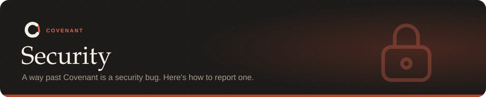

Covenant is a guard between a coding agent and your repository, so a way for an agent to get
past it is a security bug. For example:

- an action that breaks an enforced rule without being blocked, reported or rolled back;
- changing Covenant's own files, hooks or state without the tamper check noticing;
- a crash that lets a tool call through instead of failing closed;
- the hook server, daemon or dashboard answering requests from outside the machine or from
  other web pages.

## Reporting

> [!IMPORTANT]
> Please report privately using GitHub's **Report a vulnerability** button on the repository's
> **Security** tab, not in a public issue.

Include:

- the steps to reproduce;
- the Covenant version (`covenant --version`);
- your OS, and the agent involved if any.

You should hear back within a week. Once a fix is released, you'll be credited unless you'd
rather not be.

## Supported versions

Fixes go into the latest release on [PyPI](https://pypi.org/project/covenant-agents/).

## Known limits

The [safety model](docs/safety.md) describes what Covenant does not protect against, such as an
agent that runs with the same permissions as Covenant itself outside the sandbox. Those limits
aren't vulnerabilities, but ideas for closing them are welcome.
