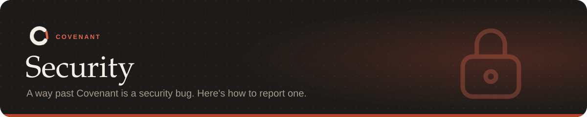

Covenant checks repository rules through local hooks, CI and a Docker sandbox. Please
report failures inside the [documented safety boundaries](docs/safety.md), including

- an action that breaks an enforced rule without being blocked, reported or rolled back;
- changing Covenant's own files, hooks or state without the tamper check noticing;
- a preflight error that lets a covered tool call through;
- unauthorized use of a protected hook or dashboard endpoint;
- a failure of a documented Docker network or state boundary.

## Reporting

> [!IMPORTANT]
> Please report privately using GitHub's **Report a vulnerability** button on the repository's
> **Security** tab, not in a public issue.

Include enough detail to reproduce the issue in a disposable repository:

- Steps, expected behavior, actual result, and relevant logs with tokens and private data removed.
- Covenant version (`covenant --version`) and installation source. Include the commit SHA
  for a checkout or candidate wheel.
- OS, Python and Git versions, plus the agent and hook or sandbox integration involved.

You should hear back within a week. Once a fix is released, you'll be credited unless you'd
rather not be.

## Supported versions

Security fixes target the latest published release. The compatibility page tracks differences
between the latest wheel and the current source.
[PyPI](https://pypi.org/project/covenant-agents/) · [Compatibility](docs/compatibility.md)

## Known limits

Local hooks share the host user's permissions. The Docker integration adds network and state
boundaries with the scope described in the safety model.
[Enforcement limits](docs/safety.md#limits) · [Docker verification](docs/safety.md#docker-verification)
