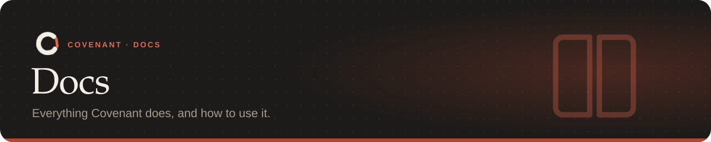

  <a href="../README.md">← Back to the README</a> &nbsp;·&nbsp;
  <a href="getting-started.md"><b>Start here</b></a> &nbsp;·&nbsp;
  <a href="faq.md">FAQ</a>

 

## Guides

<table>
<tr>
<td width="50%" valign="top">

<a href="getting-started.md"><b>Getting started</b></a> 
Install, write your first rules, see what happens when the agent breaks one, and remove Covenant if you need to.
</td>
<td width="50%" valign="top">

<a href="rules.md"><b>Rules</b></a> 
All 19 checkers, the phrases the compiler understands, the 16 kinds of refused command, rule packs and step rules.
</td>
</tr>
<tr>
<td valign="top">

<a href="covenant-yaml.md"><b>The rules file</b></a> 
<code>covenant.yaml</code> field by field: kinds, what happens on a violation, and every checker's settings.
</td>
<td valign="top">

<a href="agents.md"><b>Agents</b></a> 
Claude Code hooks, Cursor and Codex over MCP, any agent with <code>record</code>, git hooks, the hook server, Docker and VS Code.
</td>
</tr>
<tr>
<td valign="top">

<a href="ci.md"><b>CI</b></a> 
The GitHub Action with line comments, <code>covenant ci</code> on any CI system, and how a pull request is judged.
</td>
<td valign="top">

<a href="tools.md"><b>Tools</b></a> 
The dashboard and task replay, undo, explain, Slack/webhook/email alerts, suggest and team policies.
</td>
</tr>
<tr>
<td valign="top">

<a href="commands.md"><b>Commands</b></a> 
Every command and flag, exit codes, environment variables, and where Covenant keeps its files.
</td>
<td valign="top">

<a href="safety.md"><b>Safety model</b></a> 
What Covenant guarantees, its limits, measured precision, and what isn't built yet.
</td>
</tr>
<tr>
<td valign="top">

<a href="faq.md"><b>FAQ</b></a> 
API keys, other agents, privacy, overriding a rule, speed, monorepos, and fixes for common problems.
</td>
<td valign="top">

<a href="../bench/README.md"><b>Benchmark</b></a> 
CovenantBench, live trials with Claude Code on 4 repos, and the replay of 1,446 commits from 50 repos.
</td>
</tr>
</table>

## Common tasks

| I want to… | Read |
|---|---|
| Try Covenant on a repo in two minutes | [Getting started](getting-started.md) |
| Stop an agent from force pushing, deploying or running `DROP TABLE` | [Refused commands](rules.md#refused-commands) |
| Keep an agent inside `src/` | [What the compiler understands](rules.md#what-the-compiler-understands) |
| Make sure tests pass before every commit | [Rules over the agent's steps](rules.md#rules-over-the-agents-steps) |
| Cap a task's time or cost | [Budgets](rules.md#refused-commands) |
| Use Covenant with Cursor or Codex | [MCP clients](agents.md#cursor-codex-and-other-mcp-clients) |
| Check pull requests | [GitHub Action](ci.md#github-action) |
| Undo what an agent did | [Undo](tools.md#undo) |
| Get a Slack message when an agent is stuck | [Alerts](tools.md#alerts) |
| Share rules across a team | [Team policies](tools.md#team-policies) |
| Tune a rule by hand | [Checker settings](covenant-yaml.md#checker-settings) |

## Elsewhere in the repo

| | |
|---|---|
| [VS Code extension](../vscode-extension/README.md) | The editor panel, its commands and settings |
| [Changelog](../CHANGELOG.md) | What changed in each release |
| [Contributing](../CONTRIBUTING.md) | Setup, tests, and how to add a checker |
| [Security](../SECURITY.md) | How to report a way around Covenant |
