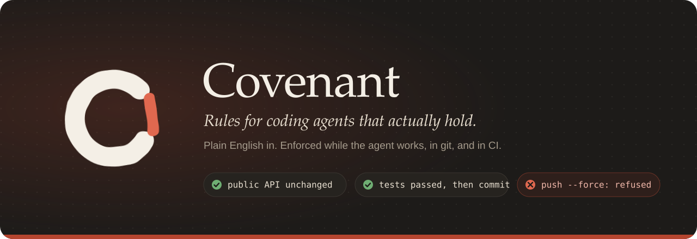
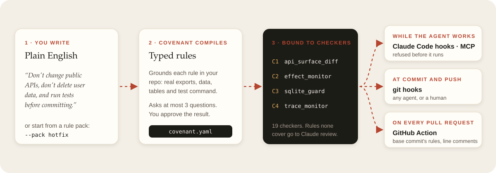

<h1 align="center">Docs</h1>

<a href="../README.md">← Back to the README</a>

New here? Start with the [quick start](../README.md#quick-start): two commands in a repo and
the rules are enforced.

## Guides

| Page | Read it to… |
|---|---|
| 📏 [Rules](rules.md) | see every checker, the phrases the compiler understands, refused commands, rule packs and rules over the agent's steps |
| 🤖 [Agents](agents.md) | set up Claude Code, Cursor, Codex and other MCP clients, the hook server, the Docker sandbox and VS Code |
| ✅ [CI](ci.md) | check pull requests with the GitHub Action or `covenant ci` |
| 🧰 [Tools](tools.md) | use the dashboard, undo, explain, alerts, suggest and team policies |
| ⌨️ [Commands](commands.md) | look up a command, flag, exit code or environment variable |
| 🛡️ [Safety model](safety.md) | understand what Covenant protects against, and its limits |

## Elsewhere in the repo

| | |
|---|---|
| [CovenantBench](../bench/README.md) | The benchmark, its metrics, and the live trials on real repos |
| [VS Code extension](../vscode-extension/README.md) | The editor panel and its commands |
| [Changelog](../CHANGELOG.md) | What changed in each release |
| [Contributing](../CONTRIBUTING.md) | Setup, tests, and how to add a checker |
| [Security](../SECURITY.md) | How to report a way around Covenant |
