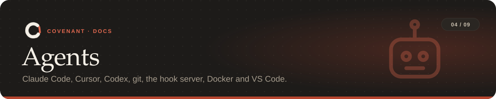

<p align="center"></p>

<p align="center"><sub><a href="../README.md">Covenant</a> › <a href="README.md">Docs</a> › Agents</sub></p>

Choose an integration based on the checkpoints you need. Git hooks and CI can check changes
from any author. Preflight checks and step rules depend on which events the integration records.

**On this page:** [Claude Code](#claude-code) · [Cursor, Codex and other MCP clients](#cursor-codex-and-other-mcp-clients) ·
[Any other agent](#any-other-agent) · [Git hooks](#git-hooks) · [Hook server](#hook-server) ·
[Sandbox](#sandbox) · [VS Code](#vs-code)

| Integration | Action and event coverage | Git checkpoints |
|---|---|---|
| Claude Code | Tool preflight and session events through installed Claude Code hooks | Installed Git hooks can independently check commits and pushes |
| Cursor, Codex and other MCP clients | Checks and events when the client calls Covenant's tools | Install Git hooks separately |
| Other agents and scripts | Events supplied through `covenant record` and `covenant test` | Install Git hooks separately |
| Docker sandbox | Claude Code HTTP hooks when using Claude Code, plus a proxy and separate hook state | Git hooks provided inside the container |

Configure [CI](ci.md) separately to check repository changes from any of these integrations.

---

## Claude Code

`covenant init` (or `covenant install-claude`) adds hooks to `.claude/settings.json`:

| Hook | What Covenant does |
|---|---|
| `SessionStart` | Starts a session and tells Claude the rules |
| `PreToolUse` | Denies commits and pushes that would break a rule, edits to protected or someone else's files, refused commands, web fetches and database tool calls, actions past a budget, changes to Covenant's own files, and hook bypasses (`--no-verify`, `core.hooksPath`). Takes a restore point before risky steps |
| `PostToolUse` / `PostToolUseFailure` | Records edits, commands and test runs, and reports side effects found by the snapshot scan |
| `Stop` | Claude can't finish while a rule is broken |

If the same rule blocks Claude **5 times**, Covenant stops it and hands the task to you (and
sends an [alert](tools.md#alerts) if you set one up).

> [!NOTE]
> The hook fails closed: if it crashes before a tool call, the call is denied.

| Flag | Effect |
|---|---|
| `covenant init --local` | Write the hooks to `.claude/settings.local.json` (not committed) |
| `covenant init --no-claude` / `--no-git` | Skip the Claude Code hooks / the git hooks |
| `covenant init --no-fast-hooks` | Start a fresh Python for every hook instead of using the daemon |

### Fast hooks

Each hook starts a tiny client that uses only Python's standard library and hands the event to
a background `covenant daemon` for the repo, which keeps Covenant loaded.

- A historical Windows measurement was about **0.2 s** per agent action. The labeled hook
  benchmark measures in-process checks separately. [Benchmark methodology](../bench/README.md#labeled-hook-decisions)
- When no daemon answers, the client runs the full check itself and starts one, so a missing
  daemon never skips a check.
- The daemon listens on 127.0.0.1 only, exits after 30 idle minutes (`--idle` seconds), and
  restarts when Covenant is upgraded. `COVENANT_NO_DAEMON=1` turns it off for one shell.

### Several agents in one repo

Give each agent a name with `COVENANT_AGENT`, and use [path ownership](rules.md#refused-commands)
rules to keep them in their own folders:

```bash
COVENANT_AGENT=payments claude
```

## Cursor, Codex and other MCP clients

`covenant --repo <path> mcp` is an MCP server with these tools:

| Tool | What it does |
|---|---|
| `covenant_rules` | The rules for this task, and how to run the tests. Agents should read it first |
| `covenant_preflight` | Says whether a commit or push would be allowed right now, and why not |
| `covenant_check_command` | Checks a shell command against the refused-command rules before running it |
| `covenant_record_edit` | Tells Covenant about an edit it can't see |
| `covenant_run_tests` | Runs the declared tests and records the result |
| `covenant_check` | Runs every check now |
| `covenant_explain` | Why something was blocked, and what can be done |

<table>
<tr><th>Cursor</th><th>Codex</th></tr>
<tr><td>

```json
{
  "mcpServers": {
    "covenant": { "command": "covenant", "args": ["--repo", ".", "mcp"] }
  }
}
```

</td><td>

```toml
# ~/.codex/config.toml
[mcp_servers.covenant]
command = "covenant"
args = ["--repo", "/path/to/repo", "mcp"]
```

</td></tr>
</table>

The Cursor example belongs in `.cursor/mcp.json`. Use an absolute repository path if the
client launches the server from a different directory.

> [!IMPORTANT]
> MCP only works when the agent chooses to call it, so for these agents the [git hooks](#git-hooks)
> (and [CI](ci.md)) are what enforce commits and pushes. Tell the agent to call
> `covenant_rules` first and `covenant_check_command` before shell commands.

## Any other agent

Tools and scripts can feed Covenant events for step rules and side-effect checks. These
commands report events that already happened. Use `covenant test` to execute and record the
declared tests.

```bash
covenant record edit src/app.py
covenant record run "python -m pytest -q" --exit-code 0
covenant record commit --sha abc123
covenant record push --remote origin
covenant record effect delete data/users.db         # --db when the target is a table
```

## Git hooks

`covenant init` installs `pre-commit` and `pre-push` hooks and starts a task.
`covenant install-hooks` installs only the hooks. Git invokes them at commit and push.
The current source refuses installation when either hook belongs to another tool or when
`core.hooksPath` redirects hooks. PyPI 0.1.2 overwrites existing hooks in the default
directory. [Compatibility](compatibility.md)

To use existing hooks in Git's default directory, add the corresponding call to each hook
before its successful exit. That hook must return a nonzero status when Covenant fails.

```sh
# In .git/hooks/pre-commit
covenant hook pre-commit || exit $?

# In .git/hooks/pre-push
covenant hook pre-push || exit $?
```

Run `covenant init --no-git` after wiring the hooks so Covenant pins the finished setup.
Start a new task with `covenant start` after later hook changes. Set an absolute Covenant
executable path if Git's environment lacks it. Covenant reports custom `core.hooksPath`
settings as an integrity issue, even if installation is skipped.

## Hook server

`covenant serve --install` installs Claude Code HTTP hooks and Git hooks that call the server
with `curl`. Run `covenant start` in a second terminal after installation to approve the
changed hook files, using the same repository, rules file and state directory. Git refuses
commits and pushes through these hooks if the server is unreachable.

| Flag | Default | Meaning |
|---|---|---|
| `--port` | `8787` | Port to listen on |
| `--bind` | `127.0.0.1` | Address to listen on |
| `--url` | `http://127.0.0.1:<port>` | The address hooks should call (when it differs, as in a container) |
| `--install` | | Point the hooks at this server, then start it |
| `--start-task` | | Approve the current rules and pin baselines before serving. Use with hooks that already point to the server |

Task state and snapshots live with the server. Hook requests require a bearer token stored
in the state directory or supplied through `COVENANT_HOOK_TOKEN`. Processes that can read
the hook settings can use the same token.

## Sandbox

`covenant sandbox` runs three Docker services. The agent and hook service attach to an internal
network. The proxy also attaches to an outside network for allowlisted HTTP and HTTPS requests.

```text
   ┌─────────────┐      hook events      ┌─────────────┐
   │    agent    │ ────────────────────▶ │    hooks    │   covenant serve, with the task's
   │ your repo + │                       │             │   state in a volume the agent
   │ Claude Code │                       └─────────────┘   can't see
   └──────┬──────┘
          │ proxied HTTP(S)
          ▼
   ┌─────────────┐      only allowed      ┌─────────────────────────────┐
   │    proxy    │ ─────────────────────▶ │ api.anthropic.com,          │
   │ 403 for the │                        │ your allow_hosts, --allow   │
   │    rest     │                        └─────────────────────────────┘
   └─────────────┘
```

The agent container mounts the working repository with write access and mounts the generated
hook configuration read-only. The hook service keeps runtime state in its own volume.
The proxy allows Anthropic endpoints by default and adds hosts from network rules and repeatable
`--allow` flags, including subdomains. The agent image comes with Claude Code, Git, Python and
`curl`. Launching Claude Code can use `ANTHROPIC_API_KEY` or `CLAUDE_CODE_OAUTH_TOKEN`
from the host environment.

Use Docker Compose v2 and run from a disposable checkout while trying the sandbox. The rules
file must be inside the mounted repository, and the host state directory must be outside it.
`--print` generates the files and shows the Compose commands. A normal run stops the services
when the agent command exits.

```bash
covenant sandbox                        # runs Claude Code
covenant sandbox -- my-agent --go       # or any command
covenant sandbox --allow registry.npmjs.org
covenant sandbox --print                # writes the files and shows the docker compose commands
```

> [!WARNING]
> The hook token is in the agent's settings, so a determined agent could post made-up hook
> events. The server still checks commits, pushes and diffs itself, but a made-up "tests passed"
> would count. Run tests independently when their provenance matters. See the
> [sandbox verification and limits](safety.md#docker-verification).

## VS Code

The extension in `vscode-extension/` adds a Covenant panel, the current violations in Problems,
a 🔒 badge on protected files, and commands to compile rules, approve them and run tests. It
updates live as an agent's hooks record events, and its checks never change files.

See the [extension's README](../vscode-extension/README.md) for its commands, settings and
build. A built `.vsix` is attached to each [GitHub release](https://github.com/visweshdev/Covenant/releases).

---

<table width="100%"><tr>
<td align="left"><a href="covenant-yaml.md">← The rules file</a></td>
<td align="right"><a href="ci.md">CI →</a></td>
</tr></table>
