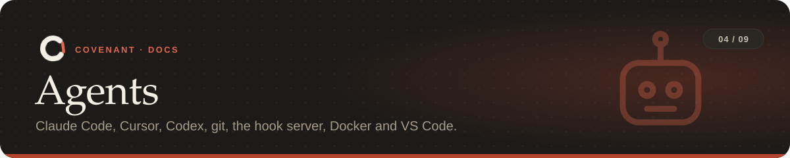

<p align="center"></p>

<p align="center"><sub><a href="../README.md">Covenant</a> › <a href="README.md">Docs</a> › Agents</sub></p>

Covenant enforces the same rules whichever agent does the work. Pick the setup that matches
yours; the git hooks and CI cover everyone.

**On this page:** [Claude Code](#claude-code) · [Cursor, Codex and other MCP clients](#cursor-codex-and-other-mcp-clients) ·
[Any other agent](#any-other-agent) · [Git hooks](#git-hooks) · [Hook server](#hook-server) ·
[Sandbox](#sandbox) · [VS Code](#vs-code)

| Agent | Before an action | At commit and push | In CI |
|---|:-:|:-:|:-:|
| Claude Code | ✅ hooks | ✅ | ✅ |
| Cursor, Codex, MCP clients | ☑️ when the agent calls the MCP tools | ✅ | ✅ |
| Any agent, or a human | ☑️ with `covenant record` | ✅ | ✅ |
| Anything in `covenant sandbox` | ✅ plus network and state isolation | ✅ | ✅ |

---

## Claude Code

`covenant init` (or `covenant install-claude`) adds hooks to `.claude/settings.json`:

| Hook | What Covenant does |
|---|---|
| `SessionStart` | Starts a session and tells Claude the rules |
| `PreToolUse` | Denies commits and pushes that would break a rule, edits to protected or someone else's files, refused commands, web fetches and database tool calls, actions past a budget, changes to Covenant's own files, and hook bypasses (`--no-verify`, `core.hooksPath`). Takes a restore point before risky steps |
| `PostToolUse` / `PostToolUseFailure` | Records edits, commands and test runs, and reports side effects found by the snapshot scan |
| `Stop` | Claude can't finish while a rule is broken |

If the same rule blocks Claude **5 times**, Covenant stops it and hands the task to you (and
sends an [alert](tools.md#alerts) if you set one up).

> [!NOTE]
> The hook fails closed: if it crashes before a tool call, the call is denied.

| Flag | Effect |
|---|---|
| `covenant init --local` | Write the hooks to `.claude/settings.local.json` (not committed) |
| `covenant init --no-claude` / `--no-git` | Skip the Claude Code hooks / the git hooks |
| `covenant init --no-fast-hooks` | Start a fresh Python for every hook instead of using the daemon |

### Fast hooks

Each hook starts a tiny client that uses only Python's standard library and hands the event to
a background `covenant daemon` for the repo, which keeps Covenant loaded.

- About **0.2 s** per agent action on Windows, instead of about 1 s.
- When no daemon answers, the client runs the full check itself and starts one, so a missing
  daemon never skips a check.
- The daemon listens on 127.0.0.1 only, exits after 30 idle minutes (`--idle` seconds), and
  restarts when Covenant is upgraded. `COVENANT_NO_DAEMON=1` turns it off for one shell.

### Several agents in one repo

Give each agent a name with `COVENANT_AGENT`, and use [path ownership](rules.md#refused-commands)
rules to keep them in their own folders:

```bash
COVENANT_AGENT=payments claude
```

## Cursor, Codex and other MCP clients

`covenant --repo <path> mcp` is an MCP server with these tools:

| Tool | What it does |
|---|---|
| `covenant_rules` | The rules for this task, and how to run the tests. Agents should read it first |
| `covenant_preflight` | Says whether a commit or push would be allowed right now, and why not |
| `covenant_check_command` | Checks a shell command against the refused-command rules before running it |
| `covenant_record_edit` | Tells Covenant about an edit it can't see |
| `covenant_run_tests` | Runs the declared tests and records the result |
| `covenant_check` | Runs every check now |
| `covenant_explain` | Why something was blocked, and what can be done |

<table>
<tr><th>Cursor</th><th>Codex</th></tr>
<tr><td>

```json
// .cursor/mcp.json
{
  "mcpServers": {
    "covenant": { "command": "covenant", "args": ["--repo", ".", "mcp"] }
  }
}
```

</td><td>

```toml
# ~/.codex/config.toml
[mcp_servers.covenant]
command = "covenant"
args = ["--repo", "/path/to/repo", "mcp"]
```

</td></tr>
</table>

> [!IMPORTANT]
> MCP only works when the agent chooses to call it, so for these agents the [git hooks](#git-hooks)
> (and [CI](ci.md)) are what enforce commits and pushes. Tell the agent to call
> `covenant_rules` first and `covenant_check_command` before shell commands.

## Any other agent

Any tool (or script) can feed Covenant what it did, so step rules and side-effect checks work:

```bash
covenant record edit src/app.py
covenant record run "python -m pytest -q" --exit-code 0
covenant record commit --sha abc123
covenant record push --remote origin
covenant record effect delete data/users.db         # --db when the target is a table
```

## Git hooks

`covenant init` (or `covenant install-hooks`) installs `pre-commit` and `pre-push` hooks. They
check every commit and push, whoever makes it: any agent, or a human.

> [!WARNING]
> They replace any existing `.git/hooks/pre-commit` and `pre-push`. If you use another hook
> manager (husky, pre-commit), call `covenant hook pre-commit` / `covenant hook pre-push` from it.

## Hook server

`covenant serve --install` runs Covenant as a long-lived local server and points Claude Code
(HTTP hooks, at `/hook`) and the git hooks (via `curl`) at it. Git refuses the commit if the
server is unreachable.

| Flag | Default | Meaning |
|---|---|---|
| `--port` | `8787` | Port to listen on |
| `--bind` | `127.0.0.1` | Address to listen on |
| `--url` | `http://127.0.0.1:<port>` | The address hooks should call (when it differs, as in a container) |
| `--install` | | Point the hooks at this server, then start it |

State and snapshots then live with the server instead of wherever the agent runs, which is the
building block for running agents in a container. Requests need a bearer token created at start
(or `COVENANT_HOOK_TOKEN`); that keeps other local processes out, but not an agent that can read
the hook settings.

## Sandbox

`covenant sandbox` runs the agent in Docker, in three containers on a private network with no
route to the internet:

```text
   ┌─────────────┐      hook events      ┌─────────────┐
   │    agent    │ ────────────────────▶ │    hooks    │   covenant serve, with the task's
   │ your repo + │                       │             │   state in a volume the agent
   │ Claude Code │                       └─────────────┘   can't see
   └──────┬──────┘
          │ all traffic
          ▼
   ┌─────────────┐      only allowed      ┌─────────────────────────────┐
   │    proxy    │ ─────────────────────▶ │ api.anthropic.com,          │
   │ 403 for the │                        │ your allow_hosts, --allow   │
   │    rest     │                        └─────────────────────────────┘
   └─────────────┘
```

So an agent that dodges a command rule (say, by writing the command into a script) still can't
reach a host that isn't allowed, or touch Covenant's state.

```bash
covenant sandbox                        # runs Claude Code
covenant sandbox -- my-agent --go       # or any command
covenant sandbox --allow registry.npmjs.org
covenant sandbox --print                # writes the files and shows the docker compose commands
```

> [!WARNING]
> The hook token is in the agent's settings, so a determined agent could post made-up hook
> events. The server still checks commits, pushes and diffs itself, but a made-up "tests passed"
> would count; run `covenant test` from outside when that matters. The sandbox hasn't been run
> end to end in Docker yet (see [Safety model](safety.md#not-built-yet)).

## VS Code

The extension in `vscode-extension/` adds a Covenant panel, the current violations in Problems,
a 🔒 badge on protected files, and commands to compile rules, approve them and run tests. It
updates live as an agent's hooks record events, and its checks never change files.

See the [extension's README](../vscode-extension/README.md) for its commands, settings and
build. A built `.vsix` is attached to each [GitHub release](https://github.com/visweshdev/Covenant/releases).

---

<table width="100%"><tr>
<td align="left"><a href="covenant-yaml.md">← The rules file</a></td>
<td align="right"><a href="ci.md">CI →</a></td>
</tr></table>
