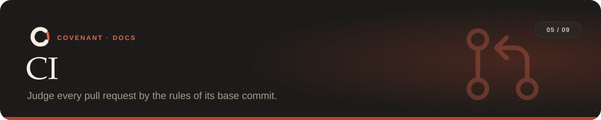

<p align="center"></p>

<p align="center"><sub><a href="../README.md">Covenant</a> › <a href="README.md">Docs</a> › CI</sub></p>

Hooks catch problems while the agent works; CI is the backstop. It checks every pull request,
whoever or whatever wrote it, against rules the pull request itself can't change.

**On this page:** [GitHub Action](#github-action) · [Other CI systems](#other-ci-systems) ·
[How a pull request is judged](#how-a-pull-request-is-judged)

---

## GitHub Action

```yaml
# .github/workflows/covenant.yml
on: pull_request
permissions:
  contents: read
  pull-requests: write          # for the comments
jobs:
  covenant:
    runs-on: ubuntu-latest
    steps:
      - uses: actions/checkout@v4
        with: { fetch-depth: 0 }  # the base commit must be there
      - uses: visweshdev/Covenant@main
        # with: { comment: "false", run-tests: "false", agent: payments }
```

| Input | Default | What it does |
|---|---|---|
| `comment` | `true` | Comment on the PR (needs `pull-requests: write`) |
| `run-tests` | `true` | Run the declared tests on the PR's final state |
| `agent` | | The agent name for [path ownership](rules.md#refused-commands) rules |
| `covenant` | `covenant.yaml` | Path to the rules file |
| `base` | the PR's target | The commit to compare against |
| `python-version` | `3.12` | Python used to run Covenant |

What you get on the pull request:

- a **comment on the exact line** that breaks a rule, posted once (re-runs don't repeat it);
- **one summary comment**, kept up to date, with problems that have no changed line to point at
  (a deleted protected file, say);
- **annotations** on the Files tab and a job summary;
- a failing check when a rule is broken.

## Other CI systems

`covenant ci` works anywhere git and Python do:

```bash
pip install covenant-agents
covenant ci --base origin/main             # text output; exit code 1 on violations
covenant ci --format json > covenant.json  # for other tools
covenant ci --format github --comment      # GitHub without the action; needs GITHUB_TOKEN
```

| Flag | What it does |
|---|---|
| `--base REF` | The commit to compare against (default: the merge base with the PR target, or `origin/main`/`master`) |
| `--format github\|json\|text` | Output format; `github` writes annotations and a job summary |
| `--no-tests` | Skip the test run |
| `--comment` | Post the PR comments (GitHub Actions) |

Exit codes: `0` clean, `1` violations, `2` needs a human, `3` bad setup.

## How a pull request is judged

- The rules come from the **base** commit, so a PR can't weaken them. A PR that changes
  `covenant.yaml` is flagged for human review.
- API, dependency and migration checkers compare against the base.
- Protected files are checked against the diff.
- Test commands run on the PR's final state (step order can't be seen in CI, so "tests before
  commit" becomes "tests pass").
- Commands and budgets are judged while the agent works, so they aren't re-checked in CI.
- [Team policy](tools.md#team-policies) rules come from the base commit too, and a PR that
  changes them is flagged.

---

<table width="100%"><tr>
<td align="left"><a href="agents.md">← Agents</a></td>
<td align="right"><a href="tools.md">Tools →</a></td>
</tr></table>
