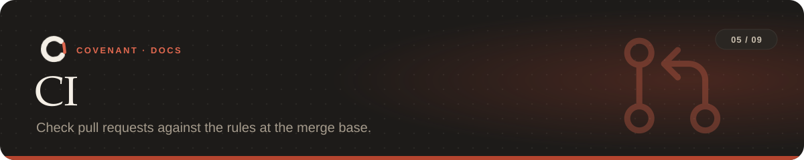

<p align="center"></p>

<p align="center"><sub><a href="../README.md">Covenant</a> › <a href="README.md">Docs</a> › CI</sub></p>

Configure CI to check the final repository diff from any contributor. Commit
`covenant.yaml` and any repository policy files to the target branch first so CI has
approved rules to evaluate.

**On this page:** [GitHub Action](#github-action) · [Other CI systems](#other-ci-systems) ·
[How a pull request is judged](#how-a-pull-request-is-judged)

---

## GitHub Action

```yaml
# .github/workflows/covenant.yml
on: pull_request
permissions:
  contents: read
jobs:
  covenant:
    runs-on: ubuntu-latest
    steps:
      - uses: actions/checkout@v4
        with:
          fetch-depth: 0
          persist-credentials: false
      - uses: visweshdev/Covenant@v0.1.2
        with:
          comment: "false"
```

| Input | Default | What it does |
|---|---|---|
| `comment` | `true` | Comment on the PR (needs `pull-requests: write`) |
| `run-tests` | `true` | Run the test commands required by the base rules on the checked-out PR state |
| `agent` | | The agent name for [path ownership](rules.md#refused-commands) rules |
| `covenant` | `covenant.yaml` | Path to the rules file |
| `base` | PR target SHA | Ref used to find the merge base with the checkout |
| `python-version` | `3.12` | Python used to run Covenant |

Install any project dependencies before the action when it will run your tests. TypeScript
API checks require Node.js and a resolvable `typescript` package.
[TypeScript setup](faq.md#troubleshooting)

The action writes annotations and a job summary. It fails when the CI evaluator emits a
report. To enable inline and summary PR comments, set `comment: "true"` and grant
`pull-requests: write`. Fork PRs normally receive a read-only token. Keep workflows that
execute PR test code on `pull_request` with limited permissions.
[GitHub's fork workflow rules](https://docs.github.com/en/actions/reference/workflows-and-actions/events-that-trigger-workflows#workflows-in-forked-repositories)

## Other CI systems

`covenant ci` works anywhere git and Python do:

```bash
pip install covenant-agents
covenant ci --base origin/main             # text output; exit code 1 on violations
covenant ci --format json > covenant.json  # for other tools
covenant ci --format github --comment      # GitHub without the action; needs GITHUB_TOKEN
```

| Flag | What it does |
|---|---|
| `--base REF` | Ref whose merge base with `HEAD` is used. Covenant tries the PR target and common default branches if needed |
| `--format github\|json\|text` | Output format; `github` writes annotations and a job summary |
| `--no-tests` | Skip the test run |
| `--comment` | Post the PR comments (GitHub Actions) |

For `covenant ci`, exit codes are `0` for no reports, `1` for any report, including a
policy change requiring human review, and `3` for a setup error.

## How a pull request is judged

- When the rules file exists at the **merge base**, Covenant reads that version and flags
  changes to it for human review. When it is absent, Covenant uses the checked-out copy and
  prints a warning. Review the initial policy PR before relying on CI enforcement.
- API, dependency and migration checkers compare against the base.
- Protected files are checked against the diff.
- Test commands run on the PR's final state (step order can't be seen in CI, so "tests before
  commit" becomes "tests pass").
- Command, budget and other local step events are evaluated through agent integrations.
- Repository [team policy](tools.md#team-policies) files come from the merge base too, and
  changing them is flagged. Machine and HTTPS policy sources resolve outside Git history.

---

<table width="100%"><tr>
<td align="left"><a href="agents.md">← Agents</a></td>
<td align="right"><a href="tools.md">Tools →</a></td>
</tr></table>
