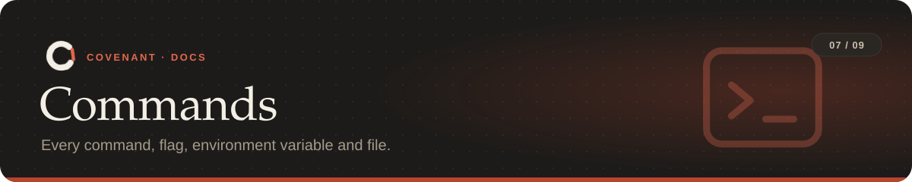

<a href="../README.md">Covenant</a> › <a href="README.md">Docs</a> › Commands

`covenant <command> --help` shows the same details in the terminal.

**On this page:** [Global flags](#global-flags) · [Rules](#set-up-and-rules) ·
[During a task](#during-a-task) · [Integrations](#integrations) · [Benchmark](#benchmark) ·
[Exit codes](#exit-codes) · [Environment variables](#environment-variables) · [Files](#files)

---

## Global flags

These go before the command: `covenant --repo ../api status`.

| Flag | Default | Meaning |
|---|---|---|
| `--repo PATH` | current folder | The repository to act on |
| `--covenant FILE` | `<repo>/covenant.yaml` | The rules file |
| `--state-dir DIR` | `~/.covenant/workspaces/<repo>-<hash>` | Where the task's state and snapshots live |
| `--version` | | Print the version |

## Set up and rules

| Command | What it does | Flags |
|---|---|---|
| `covenant compile "<instruction>"` | Writes `covenant.yaml` from plain English | `--pack NAME` (repeatable), `--offline`, `--backend auto\|api\|claude-code`, `--model`, `--no-review`, `--unattended`, `--answer Q1=2`, `--yes`, `--dry-run`, `--format text\|json` |
| `covenant packs` | Lists the rule packs and what's in them | |
| `covenant suggest` | Proposes rules from the repo's history | `--github`, `--limit N` (default 500) |
| `covenant validate` | Checks `covenant.yaml` without starting anything | |
| `covenant init` | Validates, installs git and Claude Code hooks, starts a task | `--local`, `--no-claude`, `--no-git`, `--no-fast-hooks` |
| `covenant start` | Approves the current `covenant.yaml` and begins a fresh task | |
| `covenant amend "<instruction>"` | Adds rules mid-task, keeping the history; only additions are accepted | same as `compile` (instruction optional with `--pack`) |

## During a task

| Command | What it does | Flags |
|---|---|---|
| `covenant status` | The rules and what the agent has done | `--format text\|json` |
| `covenant check` | Runs every check now | `--preview` (what a commit would face, with no rollbacks and no strike against the agent) |
| `covenant test` | Runs the declared test command and records the result | |
| `covenant explain` | Why something was blocked and what can be done | `-n N`, `--format text\|json` |
| `covenant snapshots` | Lists restore points | |
| `covenant snapshot` | Takes a restore point now | |
| `covenant undo [ID]` | Restores a restore point (default: the latest) | `--yes` |
| `covenant alerts [test]` | Shows the alert settings, or sends a test alert | |
| `covenant dashboard` | Opens the local dashboard | `--port` (8765), `--no-open`, `--read-only` |
| `covenant record ...` | Tells Covenant what an agent did, for agents without hooks: `edit PATH`, `run CMD --exit-code N`, `commit [--sha]`, `push [--remote]`, `effect OP TARGET [--db]` | |

## Integrations

| Command | What it does | Flags |
|---|---|---|
| `covenant ci` | Checks a pull request | `--base REF`, `--format text\|github\|json`, `--no-tests`, `--comment` |
| `covenant mcp` | Runs the MCP server on stdio | |
| `covenant serve` | Runs the hook server | `--port` (8787), `--bind` (127.0.0.1), `--url`, `--install` |
| `covenant sandbox [-- CMD]` | Runs the agent in Docker with the internet and Covenant's state out of reach | `--allow HOST`, `--print` |
| `covenant install-hooks` | Installs only the git hooks | |
| `covenant install-claude` | Installs only the Claude Code hooks | `--local`, `--no-fast-hooks` |
| `covenant hook pre-commit\|pre-push` | What the git hooks run; call it from another hook manager | |
| `covenant claude-hook` | What the Claude Code hooks run (reads JSON on stdin) | |
| `covenant daemon` | The background process behind the fast hooks (started automatically) | `--idle SECONDS` (1800) |

## Benchmark

| Command | What it does | Flags |
|---|---|---|
| `covenant bench run` | Runs CovenantBench tasks | `--mode` (repeatable), `--agent scripted\|command`, `--agent-cmd`, `--llm`, `--only`, `--tasks`, `--out` |
| `covenant bench report FILE...` | Scores result files | |
| `covenant bench replay [repos.txt]` | Judges real repos' recent commits with the CI check, running nothing from them | `--commits` (30), `--jobs` (4), `--only`, `--work`, `--out`, `--report FILE` |

See [bench/README.md](../bench/README.md) for both.

## Exit codes

| Code | Meaning |
|---|---|
| `0` | Clean |
| `1` | Violations: the agent should revise |
| `2` | Needs a human |
| `3` | Bad setup (no rules file, not a git repo, invalid rules) |

## Environment variables

| Variable | What it does |
|---|---|
| `ANTHROPIC_API_KEY` / `ANTHROPIC_AUTH_TOKEN` | Compile and review with the Claude API. Without either, your Claude Code login is used |
| `COVENANT_ANTHROPIC_BASE_URL` | Overrides `ANTHROPIC_BASE_URL` for Covenant only (`compile` warns when that points away from Anthropic) |
| `COVENANT_REVIEW_MODEL` | The model for `llm_review` (default `claude-sonnet-5-5`) |
| `COVENANT_HOME` | Where state is kept (default `~/.covenant`) |
| `COVENANT_AGENT` | This agent's name, for path ownership rules |
| `COVENANT_POLICY` | Team policies applied to every repo on this machine |
| `COVENANT_SNAPSHOTS` | `0` turns restore points off |
| `COVENANT_NO_DAEMON` | Set to run every hook in a fresh Python instead of the daemon |
| `COVENANT_SLACK_WEBHOOK`, `COVENANT_ALERT_WEBHOOK`, `COVENANT_ALERT_EMAIL` | Where alerts go |
| `COVENANT_SMTP_PASSWORD` | The SMTP password for email alerts (the variable name can be changed in `alerts.yaml`) |
| `COVENANT_HOOK_TOKEN` | The hook server's token (set by the sandbox) |
| `COVENANT_TYPESCRIPT` | A `typescript` package to use when the project has none installed |
| `GITHUB_TOKEN` / `GH_TOKEN` | Lets `covenant ci --comment` post to the pull request |

`suggest --github` uses the `gh` CLI's own login.

## Files

| Where | What |
|---|---|
| `covenant.yaml` | The rules ([reference](covenant-yaml.md)) |
| `.git/hooks/pre-commit`, `pre-push` | The git hooks |
| `.claude/settings.json` (or `settings.local.json`) | The Claude Code hooks |
| `~/.covenant/workspaces/<repo>-<hash>/` | The task's state: `session.json`, `trace.jsonl`, `reports.jsonl`, the approved rules, snapshots, `history/` (last 30 tasks) |
| `refs/covenant/snapshots/*` (in the repo) | Restore points; never pushed |
| `~/.covenant/alerts.yaml` | Alert settings ([format](tools.md#alerts)) |
| `~/.covenant/policies/` | Cached team policies fetched from https |

---

<table width="100%"><tr>
<td align="left"><a href="tools.md">← Tools</a></td>
<td align="right"><a href="safety.md">Safety model →</a></td>
</tr></table>
