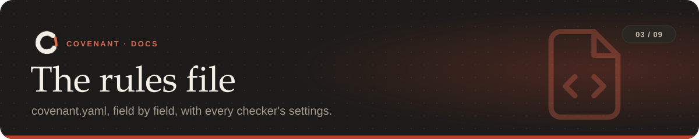

<p align="center"></p>

<p align="center"><sub><a href="../README.md">Covenant</a> › <a href="README.md">Docs</a> › The rules file</sub></p>

`covenant compile` writes `covenant.yaml` for you, and most people never edit it by hand. This
page is for when you want to read it closely, tune a rule, or write one yourself.

**On this page:** [Example](#an-example) · [Top-level fields](#top-level-fields) ·
[Rule fields](#rule-fields) · [Kinds](#kind) · [On violation](#on_violation) ·
[Status](#status) · [Checker settings](#checker-settings) · [Changing the file](#changing-the-file)

---

## An example

```yaml
covenant:
  instruction: Don't change public APIs, never force push, and run tests before committing.
  goal:
    action: update_dependencies
  extends:
    - policies/team.yaml                # team rules, merged in first
  clauses:
  - id: C1
    kind: SemanticInvariant
    source_span: Don't change public APIs
    scope: [src/mypkg/__init__.py exports]
    checker: api_surface_diff
    params: {package: mypkg, root: src, baseline: HEAD}
    assumptions: [public = names exported from src/mypkg/__init__.py]
  - id: C2
    kind: EffectProhibition
    source_span: never force push
    checker: command_guard
    params: {deny: [force_push]}
  - id: C3
    kind: TemporalObligation
    source_span: run tests before committing
    checker: trace_monitor
    params:
      formula: G(commit -> (!edit S test_pass))
      test_cmd: python -m pytest -q
```

## Top-level fields

| Field | Required | Meaning |
|---|---|---|
| `instruction` | yes | The plain-English instruction the rules came from |
| `goal` | yes | What the task is for: `action` and optional `scope` |
| `clauses` | yes | The rules (below); ids must be unique |
| `extends` | no | [Team policy](tools.md#team-policies) files or https addresses whose rules apply too |

The whole file may sit under a top-level `covenant:` key, as `compile` writes it, or not.

## Rule fields

| Field | Default | Meaning |
|---|---|---|
| `id` | | Unique id, such as `C1`. Reports and `covenant explain` name rules by it |
| `kind` | | `EffectProhibition`, `SemanticInvariant` or `TemporalObligation` ([below](#kind)) |
| `source_span` | | The exact words of the instruction this rule came from |
| `scope` | `[]` | What it applies to, in words, grounded in the repo |
| `checker` | | Which checker enforces it ([settings](#checker-settings)); required unless `status` isn't `enforced` |
| `params` | `{}` | The checker's settings |
| `on_violation` | `block` | What happens when it's broken ([below](#on_violation)) |
| `confidence` | `1.0` | How sure the compiler was, from 0 to 1 |
| `assumptions` | `[]` | What the compiler assumed, so you can check it |
| `status` | `enforced` | `enforced`, `unenforceable` or `pending_clarification` ([below](#status)) |
| `origin` | | The team policy a rule came from (set by Covenant) |

### `kind`

| Kind | Means | Checked |
|---|---|---|
| `EffectProhibition` | Something must not happen: deleting data, running a command | Before the action (commands, budgets, edits) and on every event (side effects) |
| `SemanticInvariant` | Something must stay true about the code: the API, the dependencies | At commit, push, the end of the task and in CI |
| `TemporalObligation` | Steps must happen in an order or a number of times | On every step, against the [step formula](rules.md#rules-over-the-agents-steps) |

### `on_violation`

| Value | What happens |
|---|---|
| `block` | The action, commit or push is refused, and the agent is told why and how to fix it |
| `rollback` | Like `block`, and protected files or SQLite rows are put back from a snapshot |
| `ask_human` | The agent is stopped and the task is handed to you |
| `warn` | Reported to the agent and to you, but never blocks (used by `llm_review`) |

Whatever the setting, if the same rule blocks the agent **5 times**, Covenant hands over to you.

### `status`

| Value | Means |
|---|---|
| `enforced` | Checked |
| `unenforceable` | Kept so you can see it, but nothing checks it (no checker fits, or offline with no Claude review) |
| `pending_clarification` | Not checked until a detail is settled: which files, what size limit, which test command |

## Checker settings

Every checker also takes `baseline`: the git commit to compare against. Covenant pins it to the
commit the task started from, so you rarely set it. Checkers that read the diff take `exclude`
(globs to ignore) too.

<details open>
<summary><b>API and dependencies</b></summary>

| Checker | Setting | Meaning |
|---|---|---|
| `api_surface_diff` (Python) | `package` | Import name, such as `mypkg` |
| | `root` | Folder holding the package, such as `src` (default: repo root) |
| | `extra_modules` | Modules that count as public without being exported |
| | `allow_additive` | New exports are fine (default `true`) |
| `ts_api_surface_diff` | `entries` | Entry files (default: found from `package.json` and `tsconfig`) |
| | `allow_additive` | New exports are fine (default `true`) |
| `source_api_diff` (Go, Rust, Java) | `language` | `go`, `rust` or `java` (default: detected) |
| | `roots` | Folders to scan (default: per language) |
| | `allow_additive` | New public items are fine (default `true`) |
| `dependency_diff` | `allow` | Packages that may change (empty: any) |
| | `allow_new` | New dependencies may be added (default `true`) |
| | `allow_removed` | Dependencies may be removed (default `false`) |
| | `deny_major` | Locked versions keep their major version (default `true`) |
| | `lockfiles` | Compare lockfiles too (default `true`); `false` checks only declared packages |
</details>

<details open>
<summary><b>Data and migrations</b></summary>

| Checker | Setting | Meaning |
|---|---|---|
| `effect_monitor` | `deny` | Operations to forbid: `delete` (renames and drops count), `truncate`, `overwrite` (default `[delete]`) |
| | `paths` | Protected globs, repo-relative or `~/...`; `**` crosses folders |
| | `exclude` | Globs carved out of `paths` |
| | `db_tables` | Protected table names |
| `sqlite_guard` | `databases` | SQLite files (paths or globs) |
| | `tables` | Only these tables (default: all) |
| | `forbid_updates` | Changed values count too (default `false`) |
| `schema_guard` | `dirs` | Migration folders (default: common locations) |
| | `allow` | Operations to permit, such as `drop_index` |
</details>

<details open>
<summary><b>The change itself</b></summary>

| Checker | Setting | Meaning |
|---|---|---|
| `scope_guard` | `allow` | Globs that may change, such as `src/**` |
| | `allow_new` | New files may be added (default `true`) |
| | `allow_delete` | Files may be deleted or renamed (default `true`) |
| `secret_scan` | | No settings beyond `exclude` |
| `test_guard` | `test_files` | Globs that count as tests (default: common layouts) |
| `diff_budget` | `max_files` | Most files that may change |
| | `max_lines` | Most lines that may change |
| `no_debug_code` | `include_print` | Python `print()` counts too (default `false`) |
| `no_suppressions` | `kinds` | Any of `type`, `lint`, `coverage` (default: all) |
| `large_files` | `max_kb` | Size limit per file (default `1024`) |
| `llm_review` | `rule` | What Claude should check (default: the rule's words) |
</details>

<details open>
<summary><b>Commands, budgets, ownership and steps</b></summary>

| Checker | Setting | Meaning |
|---|---|---|
| `command_guard` | `deny` | [Categories](rules.md#refused-commands) to refuse, such as `[force_push, publish]` |
| | `patterns` | Extra regular expressions to refuse |
| | `allow_hosts` | With `network`: hosts (and their subdomains) that may be reached |
| `budget` | `max_minutes` | Minutes since the task started |
| | `max_actions` | Edits, commands, web and MCP calls (reads and searches don't count) |
| | `max_cost_usd` | Estimated spend, from Claude Code's session log |
| `path_owner` | `owners` | `{"billing/**": ["payments"]}`: which agents may change which folders |
| `trace_monitor` | `formula` | A [step formula](rules.md#rules-over-the-agents-steps) |
| | `test_cmd` | The command that counts as a test run |
</details>

## Changing the file

- `covenant validate` checks the file without starting anything.
- `covenant start` approves it and begins a fresh task. Until then, an edited file is reported
  as an `INTEGRITY` problem: the approved copy is pinned so an agent can't relax its own rules.
- `covenant amend "..."` adds rules without restarting; it only accepts additions.
- The [dashboard](tools.md#dashboard) does all three from a page.

---

<table width="100%"><tr>
<td align="left"><a href="rules.md">← Rules</a></td>
<td align="right"><a href="agents.md">Agents →</a></td>
</tr></table>
