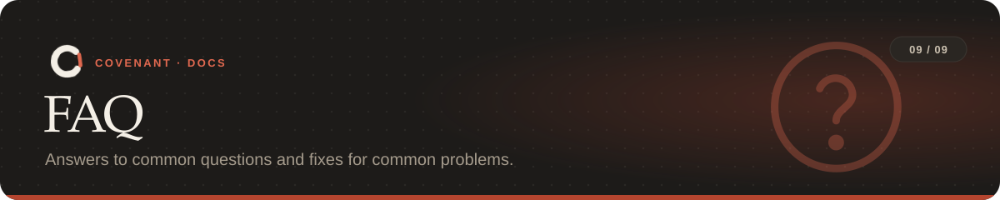

<a href="../README.md">Covenant</a> › <a href="README.md">Docs</a> › FAQ

**On this page:** [Questions](#questions) · [Troubleshooting](#troubleshooting)

---

## Questions

<b>Do I need an Anthropic API key?</b>

Use `covenant compile --offline` for the built-in pattern extractor, or
`--backend claude-code` with a logged-in Claude Code CLI. The API route uses
`ANTHROPIC_API_KEY` or `ANTHROPIC_AUTH_TOKEN`. Current source installs need the `anthropic`
extra for that route. The advisory `llm_review` checker can also call Claude.
[Compiler options](rules.md#compiling)

<b>Does it work with agents other than Claude Code?</b>

Cursor and Codex can call the MCP server. Git hooks and CI check changes from any author
when installed. Claude Code's tool hooks can respond to supported events before an action runs.
[Integration coverage](agents.md)

<b>Does it send my code anywhere?</b>

Deterministic verifiers run locally. Claude-assisted compilation can send your instruction
and repository summary to Claude, and `llm_review` can send a diff. Alerts and remote team
policies use their configured destinations. Use `--offline` to compile with the built-in extractor.

<b>How do I let the agent do something a rule forbids?</b>

Change the rule: edit `covenant.yaml` and run `covenant start`, or use the
[dashboard](tools.md#dashboard). To add a rule without restarting, use `covenant amend`. Rules
can't be relaxed mid-task by editing the file alone; that's reported as tampering.

<b>What happens when the agent keeps hitting the same rule?</b>

After 5 blocks of the same rule, Covenant stops the agent and hands over to you. `covenant
explain` says what happened, and an [alert](tools.md#alerts) can tell you on Slack or by email.

<b>Does it slow the agent down?</b>

A historical Windows measurement recorded about 0.2 s per action with fast hooks.
Historical replay had a median of 2.2 s per commit across its sample. The [benchmark notes](../bench/README.md)
describe the separate measurements and what they include.

<b>Can I use it in a monorepo?</b>

Yes. Rules, hooks and CI work on the whole repository. The TypeScript API check finds the
package named like the repo; for others, set `entries` on the rule. The Python check takes
`package` and `root`.

<b>Is it safe to commit <code>covenant.yaml</code>?</b>

Yes, and you should: CI reads it from the base commit. Use `covenant init --local` if you'd
rather not commit the Claude Code hook settings.

## Troubleshooting

| Problem | Fix |
|---|---|
| `covenant: command not found` after installing | Open a new terminal. With pipx, run `pipx ensurepath` once |
| Windows install fails with a long-path error | Install into a short path (one dependency has very long file names), or turn on Windows long paths |
| Every commit is blocked with "run tests before committing" | Run the declared command: `covenant test`. Runs of a subset (`-k`, a single file) or with piped output don't count |
| The wrong test command was picked | Answer the compiler's question, or edit `params.test_cmd` on the relevant rule in `covenant.yaml` and run `covenant start` |
| "Don't change public APIs" is `unenforceable` | No package was found. Set `package`/`root` (Python), `entries` (TypeScript) or `language` (Go, Rust, Java) on the rule |
| TypeScript API check fails: typescript not found | Install the project's dependencies, or point `COVENANT_TYPESCRIPT` at any `typescript` package |
| An `INTEGRITY` problem after editing `covenant.yaml` | Expected: run `covenant start` to approve the new rules |
| I already use Git hooks | Use `covenant init --no-git`, then call `covenant hook pre-commit` and `covenant hook pre-push` from your hooks in Git's default directory. See [Git hooks](agents.md#git-hooks) for `core.hooksPath` behavior. |
| VS Code says Covenant isn't installed | Set `covenant.pythonPath` to the interpreter that can run `python -m covenant --version`. [Extension setup](../vscode-extension/README.md#requirements) |
| `compile` warns about `ANTHROPIC_BASE_URL` | Another tool exported it; set `COVENANT_ANTHROPIC_BASE_URL=https://api.anthropic.com` |
| Hooks feel slow | Make sure fast hooks are on (the default); `COVENANT_NO_DAEMON` should be unset |
| The dashboard shows nothing | Covenant shows repos it has enforced on this machine; run `covenant init` in one first |
| A rule fires on something that's fine | Check the evidence with `covenant explain`, adjust the rule's settings ([reference](covenant-yaml.md#checker-settings)), and please [open an issue](https://github.com/visweshdev/Covenant/issues) |

---

<table width="100%"><tr>
<td align="left"><a href="safety.md">← Safety model</a></td>
<td align="right"><a href="README.md">Docs home →</a></td>
</tr></table>
