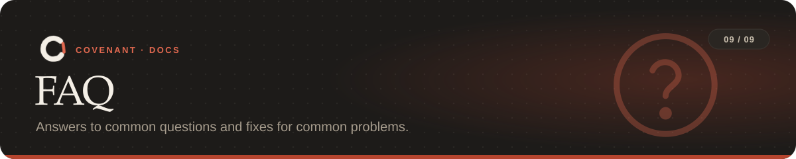

<a href="../README.md">Covenant</a> › <a href="README.md">Docs</a> › FAQ

**On this page:** [Questions](#questions) · [Troubleshooting](#troubleshooting)

---

## Questions

<b>Do I need an Anthropic API key?</b>

No. `covenant compile` uses `ANTHROPIC_API_KEY` when it's set, and your Claude Code login
otherwise, so a Claude subscription works. With neither, `--offline` uses a pattern extractor
that understands the phrases in [this table](rules.md#what-the-compiler-understands). Packs always
compile offline. Enforcement itself never calls Claude, except `llm_review` rules, which are
advisory.

<b>Does it work with agents other than Claude Code?</b>

Yes. Cursor, Codex and any MCP client get an MCP server; the git hooks check every commit and
push from any agent or person; CI checks every pull request. Only Claude Code's hooks can refuse
an action *before* it runs without the agent's cooperation. See [Agents](agents.md).

<b>Does it send my code anywhere?</b>

Checking is local. Compiling sends your instruction and a short summary of the repo (package
names, data folders, test commands) to Claude, unless you use `--offline`. `llm_review` rules
send the change being reviewed. Alerts go only where you point them.

<b>How do I let the agent do something a rule forbids?</b>

Change the rule: edit `covenant.yaml` and run `covenant start`, or use the
[dashboard](tools.md#dashboard). To add a rule without restarting, use `covenant amend`. Rules
can't be relaxed mid-task by editing the file alone; that's reported as tampering.

<b>What happens when the agent keeps hitting the same rule?</b>

After 5 blocks of the same rule, Covenant stops the agent and hands over to you. `covenant
explain` says what happened, and an [alert](tools.md#alerts) can tell you on Slack or by email.

<b>Does it slow the agent down?</b>

About 0.2 s per action with fast hooks (the default) on Windows. Commit checks take a couple of
seconds on a typical repository (median 2.2 s across 50 real ones).

<b>Can I use it in a monorepo?</b>

Yes. Rules, hooks and CI work on the whole repository. The TypeScript API check finds the
package named like the repo; for others, set `entries` on the rule. The Python check takes
`package` and `root`.

<b>Is it safe to commit <code>covenant.yaml</code>?</b>

Yes, and you should: CI reads it from the base commit. Use `covenant init --local` if you'd
rather not commit the Claude Code hook settings.

## Troubleshooting

| Problem | Fix |
|---|---|
| `covenant: command not found` after installing | Open a new terminal. With pipx, run `pipx ensurepath` once |
| Windows install fails with a long-path error | Install into a short path (one dependency has very long file names), or turn on Windows long paths |
| Every commit is blocked with "run tests before committing" | Run the declared command: `covenant test`. Runs of a subset (`-k`, a single file) or with piped output don't count |
| The wrong test command was picked | Answer the question during `compile` (`--answer Q1=2`), or edit `test_cmd` in `covenant.yaml` and run `covenant start` |
| "Don't change public APIs" is `unenforceable` | No package was found. Set `package`/`root` (Python), `entries` (TypeScript) or `language` (Go, Rust, Java) on the rule |
| TypeScript API check fails: typescript not found | Install the project's dependencies, or point `COVENANT_TYPESCRIPT` at any `typescript` package |
| An `INTEGRITY` problem after editing `covenant.yaml` | Expected: run `covenant start` to approve the new rules |
| My other git hooks stopped running | `covenant init` replaced them; call `covenant hook pre-commit` / `pre-push` from your hook manager instead |
| `compile` warns about `ANTHROPIC_BASE_URL` | Another tool exported it; set `COVENANT_ANTHROPIC_BASE_URL=https://api.anthropic.com` |
| Hooks feel slow | Make sure fast hooks are on (the default); `COVENANT_NO_DAEMON` should be unset |
| The dashboard shows nothing | Covenant shows repos it has enforced on this machine; run `covenant init` in one first |
| A rule fires on something that's fine | Check the evidence with `covenant explain`, adjust the rule's settings ([reference](covenant-yaml.md#checker-settings)), and please [open an issue](https://github.com/visweshdev/Covenant/issues) |

---

<table width="100%"><tr>
<td align="left"><a href="safety.md">← Safety model</a></td>
<td align="right"><a href="README.md">Docs home →</a></td>
</tr></table>
