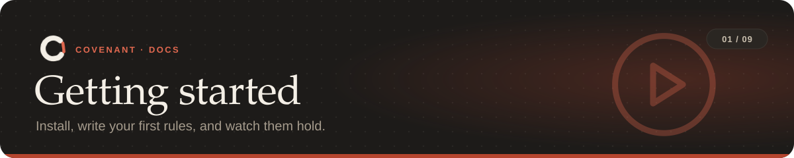

<p align="center"></p>

<p align="center"><sub><a href="../README.md">Covenant</a> › <a href="README.md">Docs</a> › Getting started</sub></p>

**On this page:** [Install](#1-install) · [Write rules](#2-write-your-rules) ·
[Approve and enforce](#3-approve-and-start-enforcing) · [Work as usual](#4-let-the-agent-work) ·
[When something is blocked](#5-when-something-is-blocked) · [Change the rules](#6-change-the-rules) ·
[Finish a task](#7-finish-or-start-a-new-task) · [Remove Covenant](#removing-covenant)

---

## 1. Install

You need **Python 3.11 or newer** and **git**. Covenant works on Windows, macOS and Linux.

```bash
pipx install covenant-agents        # or: pip install covenant-agents
covenant --version
```

<details>
<summary>Other ways to install</summary>

| | |
|---|---|
| From a checkout, with pipx set up for you | `sh install.sh` or `powershell -ExecutionPolicy Bypass -File install.ps1` |
| The newest code on GitHub | `sh install.sh --github` or `install.ps1 -GitHub` |
| For development | `pip install -e ".[dev]"` (see [CONTRIBUTING.md](../CONTRIBUTING.md)) |

On Windows, install into a short path: one of Covenant's dependencies has very long file names.
</details>

## 2. Write your rules

In the repository the agent will work in, describe the task and its limits in plain English:

```bash
cd your-repo
covenant compile "Don't change public APIs, don't delete user data, run tests before committing."
```

Covenant splits the instruction into rules, ties each one to something real in the repo (the
package's exports, the data folders, the test command), and picks a checker for each. The
output looks something like this:

```text
C1  "don't change public APIs" -> api_surface_diff
      applies to src/mypkg/__init__.py exports
C2  "don't delete user data" -> effect_monitor
      applies to data/**
C3  "run tests before committing" -> trace_monitor
      assumes tests = `python -m pytest -q` (from tests/ folder)
```

If something is ambiguous, it asks at most three questions about specific things in the repo.

| Want | Use |
|---|---|
| No Claude, fully offline | `covenant compile --offline "..."` |
| A ready-made rule set | `covenant compile --pack safe-refactor "..."` (`covenant packs` lists them) |
| Ideas from the repo's own history | `covenant suggest` |
| No questions, safe defaults | `--unattended` |

> [!TIP]
> Compiling with Claude uses `ANTHROPIC_API_KEY` when it's set, and your Claude Code login
> otherwise, so a Claude subscription is enough.

## 3. Approve and start enforcing

Read the rules Covenant wrote to `covenant.yaml` ([what's in it](covenant-yaml.md)), then:

```bash
covenant init
```

This checks the file, installs the git hooks and the Claude Code hooks, and starts a task. From
now on every agent action, commit and push is checked.

## 4. Let the agent work

Start Claude Code (or any agent) as usual. At the start of its session it's told the rules.
While it works:

- risky commands are **refused before they run** (`git push --force`, `DROP TABLE`, `curl` to a
  host that isn't allowed);
- edits to protected files are **refused**, and side effects from scripts are **rolled back**;
- a commit or push that would break a rule is **blocked**, with the reason and a fix;
- a **restore point** is taken before risky steps.

Check where things stand at any time:

```bash
covenant status      # the rules and what the agent has done
covenant check       # run every check now
covenant dashboard   # the same in a browser, with a rule editor and replay
```

## 5. When something is blocked

The agent is told which rule, the evidence and how to fix it, and usually just does that. You
can read the same story:

```bash
covenant explain
```

```text
At 01:23 on 01 Nov, the agent tried to use a tool. Covenant blocked it.

Rule C3: "never run destructive SQL"
  Why: The command counts as SQL that drops a table, database or schema: psql -c "DROP TABLE users".
  What the agent can do: Don't drop, truncate or wipe tables; change rows with a WHERE, or ask the human
```

If the same rule blocks the agent **5 times**, Covenant stops it and hands over to you. To be
told when that happens, set up [alerts](tools.md#alerts). To put files back after a mistake,
use `covenant undo` ([restore points](tools.md#undo)).

## 6. Change the rules

| Want | Do |
|---|---|
| Add a rule without losing the task's history | `covenant amend "also don't touch config/"` |
| Change or remove a rule | Edit `covenant.yaml`, then `covenant start` (starts a fresh task) |
| Do it from a page | `covenant dashboard` |

Editing `covenant.yaml` without `covenant start` is reported as tampering: the approved rules
are pinned when a task starts, so an agent can't quietly relax them.

## 7. Finish, or start a new task

When the work is done, write new rules for the next task (`covenant compile ...`) and run
`covenant start`. The old task is kept: the dashboard can replay the last 30.

## Removing Covenant

There's no uninstall command; remove the pieces by hand:

1. Delete `.git/hooks/pre-commit` and `.git/hooks/pre-push` (Covenant's, marked "Installed by covenant").
2. Remove the Covenant entries from `.claude/settings.json` (or `settings.local.json`).
3. Optionally delete `covenant.yaml` and the task's state in `~/.covenant/workspaces/`.
4. `pipx uninstall covenant-agents`.

---

<table width="100%"><tr>
<td align="left"><a href="README.md">← Docs home</a></td>
<td align="right"><a href="rules.md">Rules →</a></td>
</tr></table>
