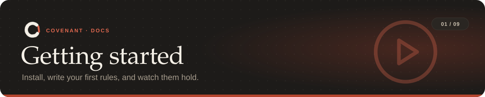

<p align="center"></p>

<p align="center"><sub><a href="../README.md">Covenant</a> › <a href="README.md">Docs</a> › Getting started</sub></p>

**On this page:** [Install](#1-install) · [Write rules](#2-write-your-rules) ·
[Approve and enforce](#3-approve-and-start-enforcing) · [Work as usual](#4-let-the-agent-work) ·
[When something is blocked](#5-when-something-is-blocked) · [Change the rules](#6-change-the-rules) ·
[Finish a task](#7-finish-or-start-a-new-task) · [Remove Covenant](#removing-covenant)

---

## 1. Install

You need **Python 3.11 or newer**, Git, and a repository with at least one commit.
Covenant works on Windows, macOS and Linux.

```bash
pipx install covenant-agents        # or: pip install covenant-agents
covenant --version
```

<details>
<summary>Other ways to install</summary>

| | |
|---|---|
| Install the PyPI release using a script from this checkout | `sh install.sh` or `powershell -ExecutionPolicy Bypass -File install.ps1` |
| Install the GitHub main branch using the same scripts | `sh install.sh --github` or `.\install.ps1 -GitHub` |
| For development | `pip install -e ".[dev]"` (see [CONTRIBUTING.md](../CONTRIBUTING.md)) |

On Windows, a short install path can help if a dependency fails with a path-length error.
</details>

## 2. Write your rules

In the repository the agent will work in, describe the task and its limits in plain English:

```bash
cd your-repo
covenant compile --offline "Don't change public APIs, don't delete user data, run tests before committing."
```

Covenant splits the instruction into rules, ties each one to something real in the repo (the
package's exports, the data folders, the test command), and picks a checker for each. On the
example project in [`examples/mylib`](../examples/mylib) it prints:

```text
C1  "Don't change public APIs" -> api_surface_diff
      applies to mylib/__init__.py exports
      assumes public = names exported from mylib/__init__.py
C2  "don't delete user data" -> effect_monitor
      applies to data/**
      assumes protected locations found in the repo: data/**
C3  'run tests before committing' -> trace_monitor
      assumes tests = `python -m pytest -q` (from tests/ folder)
```

If something is ambiguous, it asks at most three questions about specific things in the repo.

| Want | Use |
|---|---|
| Claude-assisted compilation | Omit `--offline` and configure a Claude backend |
| A ready-made rule set | `covenant compile --offline --pack safe-refactor "..."` (`covenant packs` lists them) |
| Ideas from the repo's own history | `covenant suggest` |
| Noninteractive setup | `--unattended --yes` to use conservative defaults and approve writing the file |

> [!TIP]
> Claude compilation picks the API when `ANTHROPIC_API_KEY` or `ANTHROPIC_AUTH_TOKEN` is set.
> You can also select `--backend claude-code` to use a logged-in Claude Code CLI.
> For the current source, install the `anthropic` extra to use the API. PyPI 0.1.2 bundles
> the SDK. [Compatibility](compatibility.md)

## 3. Approve and start enforcing

Read the rules Covenant wrote to `covenant.yaml` ([what's in it](covenant-yaml.md)), then:

```bash
covenant init
```

This validates the file, installs Git and Claude Code hooks, and pins the approved rules for
the task. Use `--local` to put Claude Code settings in `.claude/settings.local.json`, or
`--no-claude` for Git-only setup.

If the repository already has Git hooks, add Covenant to those hooks and run
`covenant init --no-git`. The PyPI 0.1.2 installer replaces existing default hooks, so use
`--no-git` to preserve them. [Manual Git hook setup](agents.md#git-hooks)

## 4. Let the agent work

With Claude Code hooks installed, start a new Claude Code session to receive the rules.
The hooks check supported actions and record events as the session runs.

- risky commands are **refused before they run** (`git push --force`, `DROP TABLE`, `curl` to a
  host that isn't allowed);
- covered edits to protected files are **refused**, and supported side effects can be
  **rolled back** under a rollback rule;
- a commit or push that would break a rule is **blocked**, with the reason and a fix;
- recognized risky steps can trigger a **restore point**.

With a Git-only integration, run `covenant test` to record a passing test run and report edits
with `covenant record edit PATH` when using ordering rules.
[Other agent integrations](agents.md#any-other-agent)

Check where things stand at any time:

```bash
covenant status      # the rules and what the agent has done
covenant check --preview  # inspect current violations without rollbacks
covenant dashboard   # the same in a browser, with a rule editor and replay
```

## 5. When something is blocked

The agent is told which rule, the evidence and how to fix it, and usually just does that. You
can read the same story:

```bash
covenant explain
```

```text
At 01:23 on 01 Nov, the agent tried to use a tool. Covenant blocked it.

Rule C3: "never run destructive SQL"
  Why: The command counts as SQL that drops a table, database or schema: psql -c "DROP TABLE users".
  What the agent can do: Don't drop, truncate or wipe tables; change rows with a WHERE, or ask the human
```

If the same rule blocks the agent **5 times**, Covenant stops it and hands over to you. To be
told when that happens, set up [alerts](tools.md#alerts). To put files back after a mistake,
use `covenant undo` ([restore points](tools.md#undo)).

## 6. Change the rules

| Want | Do |
|---|---|
| Add a rule without losing the task's history | `covenant amend "also don't touch config/"` |
| Change or remove a rule | Edit `covenant.yaml`, then `covenant start` (starts a fresh task) |
| Do it from a page | `covenant dashboard` |

Editing `covenant.yaml` without `covenant start` is reported as tampering: the approved rules
are pinned when a task starts, so an agent can't quietly relax them.

## 7. Finish, or start a new task

When the work is done, write new rules for the next task (`covenant compile ...`) and run
`covenant start`. The old task is kept: the dashboard can replay the last 30.

## Removing Covenant

Remove the integration from the repository before uninstalling the package.

1. Remove Git hooks marked `Installed by covenant`. For manually integrated hooks, remove
   the calls to `covenant hook` from your existing scripts.
2. Remove the Covenant hook entries from `.claude/settings.json` or `.claude/settings.local.json`.
3. If you also want to remove task history, find that repository's state directory with
   `covenant status`. Keep `covenant.yaml` if your CI workflow still uses it.
4. Run `pipx uninstall covenant-agents` or `python -m pip uninstall covenant-agents`, matching
   your install method.

---

<table width="100%"><tr>
<td align="left"><a href="README.md">← Docs home</a></td>
<td align="right"><a href="rules.md">Rules →</a></td>
</tr></table>
