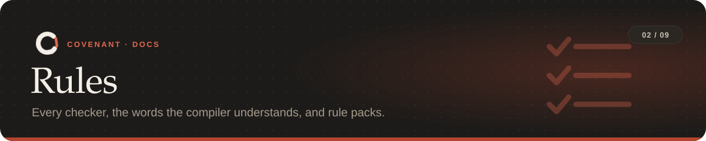

<p align="center"></p>

<p align="center"><sub><a href="../README.md">Covenant</a> › <a href="README.md">Docs</a> › Rules</sub></p>

**On this page:** [Compiling](#compiling) · [Checkers](#checkers) ·
[What the compiler understands](#what-the-compiler-understands) ·
[Refused commands](#refused-commands) · [Rule packs](#rule-packs) ·
[Rules over the agent's steps](#rules-over-the-agents-steps)

---

## Compiling

`covenant compile "<instruction>"` writes `covenant.yaml` in five passes:

| | Pass | What happens |
|---|---|---|
| 1 | **Split** | Claude, or the offline extractor with `--offline`, splits the instruction into a goal and rules |
| 2 | **Ground** | Each rule is tied to the repo: its real exports, data folders, tables and test command |
| 3 | **Bind** | Each rule gets a checker and its settings |
| 4 | **Ask** | At most three questions, each about a specific thing in the repo |
| 5 | **Validate** | The result is checked statically; then you approve it |

Claude is reached through `ANTHROPIC_API_KEY` (or `ANTHROPIC_AUTH_TOKEN`) when set, and
otherwise through your Claude Code login (`claude -p`), so a Claude subscription is enough.
`--backend api|claude-code` picks one, and `--model` picks the model (default `claude-opus-5-5`).

To add a rule mid-task, run `covenant amend "also don't touch config/"`. The new rules apply
from then on and the task's history is kept.

> [!NOTE]
> A rule with no checker ("keep the code readable") becomes an `llm_review` rule when Claude is
> available: Claude reads each commit's change against it, and its findings go to the agent and
> to you as warnings that never block. With `--offline` or `--no-review` the rule is kept and
> marked `unenforceable`, never silently dropped.

## Checkers

Each checker's settings are listed in [the rules file reference](covenant-yaml.md#checker-settings).

| Checker | Kind | What it checks |
|---|---|---|
| `api_surface_diff` | Invariant | Python exported names and signatures vs. the base commit, read with `ast` |
| `ts_api_surface_diff` | Invariant | TypeScript exported types, via the TypeScript compiler |
| `source_api_diff` | Invariant | Go, Rust and Java public API, read from source (no compiler needed) |
| `schema_guard` | Invariant | No dropped tables or columns, truncation, unqualified deletes or type changes in new migrations |
| `dependency_diff` | Invariant | Only allowed packages change; locked versions keep their major version |
| `sqlite_guard` | Invariant | Rows, tables and columns in SQLite databases are never lost (inserts are fine); checked after every step, and lost rows are put back |
| `effect_monitor` | Prohibition | Protected files and tables aren't deleted, truncated or overwritten, whatever does it; rolled back from a snapshot |
| `trace_monitor` | Obligation | Ordering, limit and deadline rules over the agent's steps ([below](#rules-over-the-agents-steps)) |
| `scope_guard` | Invariant | Only the files you name change; optionally no new or deleted files |
| `secret_scan` | Invariant | No API keys, tokens, private keys, passwords or `.env` files in the change (reports are masked) |
| `test_guard` | Invariant | Tests aren't deleted, removed, skipped or focused with `.only` |
| `diff_budget` | Invariant | The change stays within a number of files or lines |
| `no_debug_code` | Invariant | No breakpoints, `debugger`, `console.log` or (optionally) `print` left behind |
| `no_suppressions` | Invariant | No new `# type: ignore`, `@ts-ignore`, `# noqa`, `eslint-disable` and the like |
| `large_files` | Invariant | No added or changed file over a size limit |
| `command_guard` | Prohibition | Shell commands, web fetches and database tool calls refused before they run ([below](#refused-commands)) |
| `budget` | Prohibition | The task stops at a time, action or (estimated) cost limit |
| `path_owner` | Invariant | Folders that belong to one team's agent change only through that agent |
| `llm_review` | Invariant | Claude reviews each commit against a rule no checker covers; advisory, never blocks |

<details>
<summary><b>How the API checkers decide what's a breaking change</b></summary>

A change every existing caller survives isn't reported:

- **Python:** a new optional parameter; a parameter type that widens (`A` → `A | None`) or a
  return type that narrows; a new base class; `ClassVar[...]`, `@override` or `@final`; an
  import alias of the same type (`date` vs `dt_date`); a submodule that's now loaded lazily.
- **Go:** `interface{}` ↔ `any`; a new trailing variadic parameter.
- **Rust:** dropping trait bounds; `#[doc(hidden)]` items aren't API.
- **TypeScript:** a required parameter that became optional, new optional parameters;
  `_private` and `#private` members aren't API.

Removing a name, renaming or reordering parameters, changing a default, adding a required
parameter, or narrowing an accepted type is reported. These rules were tuned on
[1,446 real commits from 50 repositories](../bench/README.md#replay-on-50-real-repositories).
</details>

## What the compiler understands

| Say | Becomes |
|---|---|
| "don't change public APIs" | `api_surface_diff` / `ts_api_surface_diff` / `source_api_diff` |
| "don't delete user data", "don't touch config/" | `effect_monitor`, `sqlite_guard` |
| "no destructive migrations" | `schema_guard` |
| "only update requests", "no major upgrades" | `dependency_diff` |
| "don't add new dependencies" | `dependency_diff` (upgrades are fine; new packages aren't) |
| "only change files in src/" | `scope_guard` |
| "don't commit secrets or API keys" | `secret_scan` |
| "don't delete or skip tests" | `test_guard` |
| "keep the change under 200 lines", "touch at most 3 files" | `diff_budget` |
| "no leftover debug prints" | `no_debug_code` |
| "don't silence type errors" | `no_suppressions` (type-checker suppressions only) |
| "don't disable lint rules" / "don't suppress warnings" | `no_suppressions` (lint only / everything, coverage pragmas included) |
| "don't commit files over 5 MB" | `large_files` |
| "run tests before committing", "push at most once", "run tests within 5 steps of an edit" | `trace_monitor` |
| "never force push", "don't deploy", "don't install packages", "no network access", "don't read .env" | `command_guard` |
| "never run destructive SQL" | `command_guard` (`destructive_sql`) |
| "only reach pypi.org and github.com" | `command_guard` (`network` with `allow_hosts`) |
| "only the payments team's agent may edit billing/" | `path_owner` |
| "stop after 20 minutes", "spend at most $2", "use at most 50 tool calls" | `budget` |
| anything else ("keep the code readable") | `llm_review`, or `unenforceable` offline |

## Refused commands

`command_guard` refuses commands before they run, in Bash and PowerShell alike.

| Category | Refuses | Category | Refuses |
|---|---|---|---|
| `force_push` | a force push | `install_packages` | installing packages |
| `history_rewrite` | rewriting git history (rebase, amend, `reset --hard`) | `publish` | publishing a release |
| `branch_delete` | deleting a branch or tag | `deploy` | deploying or changing infrastructure |
| `discard_changes` | throwing away uncommitted work | `network` | network access |
| `sudo` | running as administrator | `read_secrets` | reading secret files (`.env`, keys) |
| `pipe_to_shell` | piping a download into a shell | `database_cli` | running database commands directly |
| `recursive_delete` | deleting a whole folder tree outside the task | `kill_processes` | killing processes |
| `system_changes` | changing system settings | `destructive_sql` | destructive SQL |

Add your own regular expressions with `patterns`.

<details>
<summary><b>Destructive SQL</b></summary>

Works for Postgres, MySQL, SQLite, SQL Server, DuckDB, MongoDB and Redis. Covenant reads the
SQL itself: inline (`psql -c`, `mysql -e`, piped in), in `.sql` files fed to a client, and in
database MCP tool calls. `DROP`, `TRUNCATE`, `ALTER TABLE ... DROP`, and `DELETE` or `UPDATE`
without a `WHERE` are refused; a `DELETE ... WHERE` is fine.
</details>

<details>
<summary><b>Network allowlist</b></summary>

With `allow_hosts`, only those hosts (and their subdomains) can be reached: by commands, by
`git push`/`pull` (the remote's host), by package installs (their registry, so `pip install`
needs `pypi.org`) and by the WebFetch tool. A network command whose destination can't be
worked out is refused.
</details>

<details>
<summary><b>Path ownership</b></summary>

An agent says who it is with `COVENANT_AGENT=payments claude`. Edits to folders it doesn't own
are refused, and so is a commit that changes them. An agent with no name owns nothing. In CI,
set `COVENANT_AGENT` in the job, or the action's `agent` input.
</details>

<details>
<summary><b>Budgets</b></summary>

Checked before each action. Once a limit is reached, further actions are refused and the agent
is told to stop and hand over; reading files is still allowed so it can explain where it got
to. Cost is estimated from the token counts in Claude Code's session log at Anthropic's API
prices. On a subscription nothing is charged per token, but it's still a fair measure of how
much work was done. Subagent sessions keep their own logs and aren't counted.
</details>

> [!IMPORTANT]
> `command_guard` guards against mistakes and shortcuts. An agent determined to hide a command
> (by writing it into a script first) needs the [sandbox](agents.md#sandbox).

## Rule packs

`covenant compile --pack NAME` adds a ready-made rule set to your instruction (repeat `--pack`
for several). Packs always compile offline, so a pack means the same rules everywhere.

| Pack | For | Rules |
|---|---|---|
| `safe-refactor` | restructuring code without changing what it does | public API, keep tests, no new dependencies, test before commit, no force push or history rewrite |
| `dependency-bump` | updating dependencies without breaking anything | no major upgrades, public API, keep tests, test before commit, no force push |
| `docs-only` | changing documentation and nothing else | only `docs/`, `README.md`, `CHANGELOG.md`; no new dependencies; no files over 2 MB; no force push |
| `hotfix` | a small, urgent, well-tested fix | under 100 lines, public API, keep tests, no debug prints, no suppressions, test before commit, push at most once, no force push or history rewrite |
| `data-safe` | working near user data and databases | no data loss, no destructive migrations, no destructive SQL, no deploys |
| `secure` | keeping secrets and the machine safe | no secrets, don't read `.env` or credentials, no pipe-to-shell, no sudo, no system changes |
| `lockdown` | the strictest set | public API, keep tests, no new dependencies, no secrets, no installs, no network, no force push or history rewrite, no deploy or publish, test before commit |

```bash
covenant compile --pack safe-refactor --pack secure "split utils.py into smaller modules"
covenant amend --pack hotfix              # add a pack to the current task
```

## Rules over the agent's steps

A step is one recorded action. The atoms a formula can use:

| Atom | Holds when the step is |
|---|---|
| `edit` | a file edit |
| `run` | a shell command |
| `test` | a run of the declared test command (`test_pass` / `test_fail` by its result) |
| `commit` / `push` | a commit / a push |
| `effect` | a side effect found on disk or in a database |

| Instruction | Formula |
|---|---|
| "run tests before committing" | `G(commit -> (!edit S test_pass))` |
| "never push" | `G(!push)` |
| "push at most once", "don't commit more than 3 times" | `G(#push <= 1)`, `G(#commit <= 3)` |
| "run the tests within 5 steps of any edit" | `G(!(!test S[>=5] edit))` |

| Operator | Meaning |
|---|---|
| `G(...)` | must hold at every step (outermost only; implied if left out) |
| `!a`, `a & b`, `a \| b`, `a -> b` | not, and, or, implies |
| `a S b` | *since*: `b` held at some step and `a` at every step after it |
| `Y a` / `O a` / `H a` | at the previous step / at some step so far / at every step so far |
| `O[<=n]`, `H[<=n]`, `a S[<=n] b`, `a S[>=n] b` | bounded forms that count steps back |
| `#a <= n` (also `<`, `>=`, `>`, `==`) | how often `a` has happened |

A limit counts every commit or push this task, including ones later undone with `git reset`.

### What counts as a test run

A test run counts when it runs the whole suite and its exit status is visible. Extra flags
that only change output or speed (`-x`, `-v`, `-p no:cacheprovider`, `--cov`, `-n auto`,
`2>&1`) are fine. A run that picks some tests (a path, `-k`, `-m`, `--lf`) or pipes its output
doesn't count, and the agent is told why right away. `covenant test` runs the declared command
for you.

---

<table width="100%"><tr>
<td align="left"><a href="getting-started.md">← Getting started</a></td>
<td align="right"><a href="covenant-yaml.md">The rules file →</a></td>
</tr></table>
