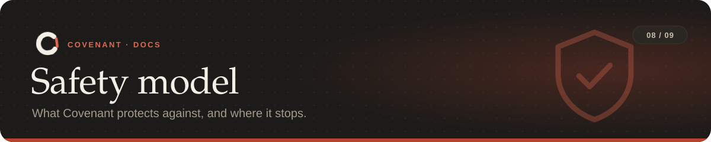

<a href="../README.md">Covenant</a> › <a href="README.md">Docs</a> › Safety model

Covenant is built for agents that mean well but take shortcuts: the force push to get past a
conflict, the deleted test that wouldn't pass, the `DROP TABLE` in a cleanup script. This page
says what it guarantees, and what needs the sandbox.

**On this page:** [What it does](#what-it-does) · [Limits](#limits) · [Not built yet](#not-built-yet)

---

## What it does

| | |
|---|---|
| 🧱 **Fails closed** | A checker that can't run blocks rather than passes, and a hook that crashes before a tool call denies the call |
| 📌 **Pins the rules** | The approved rules are pinned when a task starts. If `covenant.yaml`, the git hooks or the Claude settings change, it's an `INTEGRITY` problem, and so is `disableAllHooks` or `core.hooksPath` |
| 🚫 **Guards its own files** | Edits to the rules, hooks, settings and Covenant's state are refused, as are hook bypasses like `git commit --no-verify` |
| 🗂️ **Keeps state outside the repo** | In `~/.covenant/workspaces/<repo>-<hash>` (move it with `COVENANT_HOME`); a file lock keeps parallel hooks from corrupting it |
| 🧑‍⚖️ **Hands over** | After 5 blocks of the same rule, or on a rule set to `ask_human`, the agent is stopped and the task is yours |
| 🔁 **Can't be weakened by a PR** | CI uses the base commit's rules and flags pull requests that change them |
| 🌐 **Stays local** | The dashboard, daemon and hook server listen on 127.0.0.1 and reject other hosts and other web pages |

## Limits

> [!WARNING]
> Outside the sandbox, Covenant runs as your user. An agent with a shell could still edit its
> state folder directly. That's detected, but not prevented; [`covenant sandbox`](agents.md#sandbox)
> prevents it.

- **Side effects** are found by comparing hashes on every event, not from kernel events.
- **Databases:** SQLite databases are compared row by row. For other databases, Covenant sees the
  SQL the agent runs (commands, `.sql` files, database tools) and migrations, but not queries the
  app makes on its own.
- **Refused commands** guard against mistakes and shortcuts, not an agent determined to hide a
  command in a script. The sandbox's allowlist proxy covers the network side of that.
- **API checks** read source, not compiled artifacts. Go, Rust and Java are read without a
  compiler: a careful approximation. TypeScript uses the TypeScript compiler, and very long types
  are compared by their declaration text.
- **Git hooks** replace existing `pre-commit` and `pre-push` hooks
  ([how to combine them](agents.md#git-hooks)).
- **Measured precision:** on [1,446 real commits from 50 repositories](../bench/README.md#replay-on-50-real-repositories),
  2 of 75 flagged commits were false alarms.

## Not built yet

- **The sandbox hasn't run in Docker end to end.** Its compose file, images and allowlist proxy
  are built and tested (the proxy for real, over sockets), but the development machine has no
  Docker, so the three containers haven't been started together.
- **Live database proxy:** row-level rollback of SQL as it runs against Postgres or MySQL,
  including queries the app makes on its own. Destructive SQL the agent runs is already refused,
  and SQLite is guarded row by row.
- **A real-repo CovenantBench with agents:** the replay covers 50 repositories' history, and live
  trials covered 4 with Claude Code; the proposal's 60–200 annotated agent tasks are curation work.
- **Monorepo-wide API checks:** a monorepo's main package is found, but other packages in it
  need `entries` set by hand.

Found a way around Covenant? Please report it privately; see [SECURITY.md](../SECURITY.md).

---

<table width="100%"><tr>
<td align="left"><a href="commands.md">← Commands</a></td>
<td align="right"><a href="faq.md">FAQ →</a></td>
</tr></table>
