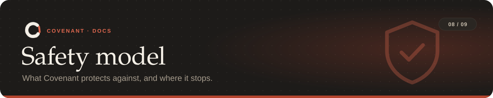

<a href="../README.md">Covenant</a> › <a href="README.md">Docs</a> › Safety model

Covenant is built for agents that mean well but take shortcuts: the force push to get past a
conflict, the deleted test that wouldn't pass, the `DROP TABLE` in a cleanup script. This page
says what it guarantees, and what needs the sandbox.

**On this page:** [What it does](#what-it-does) · [Limits](#limits) · [Docker verification](#docker-verification) · [Not built yet](#not-built-yet)

---

## What it does

| | |
|---|---|
| 🧱 **Fails closed** | A checker that can't run blocks rather than passes, and a hook that crashes before a tool call denies the call |
| 📌 **Pins the rules** | The approved rules are pinned when a task starts. If `covenant.yaml`, the git hooks or the Claude settings change, it's an `INTEGRITY` problem, and so is `disableAllHooks` or `core.hooksPath` |
| 🚫 **Guards its own files** | Edits to the rules, hooks, settings and Covenant's state are refused, as are hook bypasses like `git commit --no-verify` |
| 🗂️ **Keeps state outside the repo** | In `~/.covenant/workspaces/<repo>-<hash>` (move it with `COVENANT_HOME`); a file lock keeps parallel hooks from corrupting it |
| 🧑‍⚖️ **Hands over** | After 5 blocks of the same rule, or on a rule set to `ask_human`, the agent is stopped and the task is yours |
| 🔁 **Can't be weakened by a PR** | CI uses the base commit's rules and flags pull requests that change them |
| 🌐 **Stays local** | The dashboard, daemon and hook server listen on 127.0.0.1 and reject other hosts and other web pages |

## Limits

> [!WARNING]
> Local hooks run as your user. They can detect changes to pinned controls at a later checkpoint,
> but an agent with the same filesystem permissions can change local state or interfere with hook
> execution. [`covenant sandbox`](agents.md#sandbox) gives the hook service its own state volume and
> restricts the agent's network. Treat this as defense in depth for a cooperative coding agent.

- **Side effects** are found by comparing hashes on every event, not from kernel events.
- **Databases:** SQLite databases are compared row by row. For other databases, Covenant sees the
  SQL the agent runs (commands, `.sql` files, database tools) and migrations, but not queries the
  app makes on its own.
- **Refused commands** recognize documented patterns in tool events. Indirect execution is outside
  the command guard's coverage. Outcome checks can detect changes to protected resources at a later
  checkpoint. Proxy decisions cover requests routed through the proxy.
- **API checks** read source, not compiled artifacts. Go, Rust and Java are read without a
  compiler: a careful approximation. TypeScript uses the TypeScript compiler, and very long types
  are compared by their declaration text.
- **Git hooks** enforce the checkpoints Git invokes. The current installer preserves existing hooks
  and supports [manual integration](agents.md#git-hooks) in Git's default hook directory.
- **Replay precision:** a historical review of [1,446 commits across 50 repositories](../bench/README.md#replay-on-50-real-repositories)
  found 72 rule breaks, two false alarms and one unclear case among the 75 flags. The unflagged
  commits were unreviewed, so replay recall is unknown.

## Docker verification

The Compose smoke test builds the generated agent and hook images, starts the proxy and hook
service together, and runs the agent against a disposable Git repository. It checks the state mount
boundary, read-only configuration, allowed and denied proxy requests, direct TCP isolation from the
test origin, a blocked Git change, a legitimate commit and failure when the hook server stops.

Run `COVENANT_TEST_DOCKER=1 python -m pytest -q tests/test_docker_sandbox.py` with Docker Compose v2 or newer
and access to the image and package registries. See the [compatibility matrix](compatibility.md)
for verification status. Container escape resistance, DNS isolation and the behavior of allowed
remote services remain outside the smoke test's scope.

## Not built yet

- **Live database proxy:** row-level rollback of SQL as it runs against Postgres or MySQL,
  including queries the app makes on its own. Destructive SQL the agent runs is already refused,
  and SQLite is guarded row by row.
- **A real-repo CovenantBench with agents:** the replay covers 50 repositories' history, and live
  trials covered 4 with Claude Code; the proposal's 60–200 annotated agent tasks are curation work.
- **Monorepo-wide API checks:** a monorepo's main package is found, but other packages in it
  need `entries` set by hand.

Found a way around Covenant? Please report it privately; see [SECURITY.md](../SECURITY.md).

---

<table width="100%"><tr>
<td align="left"><a href="commands.md">← Commands</a></td>
<td align="right"><a href="faq.md">FAQ →</a></td>
</tr></table>
