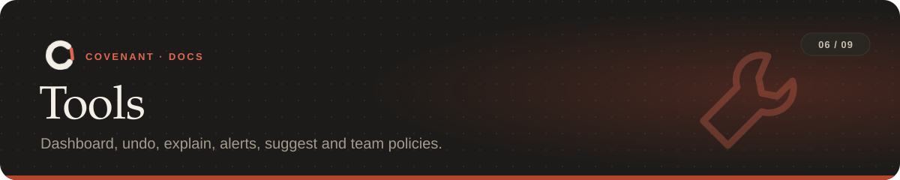

<p align="center"></p>

<p align="center"><sub><a href="../README.md">Covenant</a> › <a href="README.md">Docs</a> › Tools</sub></p>

Everything around the rules: seeing what happened, undoing it, hearing about it, and sharing
rules with a team.

**On this page:** [Dashboard](#dashboard) · [Undo](#undo) · [Explain](#explain) ·
[Alerts](#alerts) · [Suggest](#suggest) · [Team policies](#team-policies)

---

## Dashboard

```bash
covenant dashboard                 # opens http://127.0.0.1:8765
covenant dashboard --read-only     # no editing from the page
```

One page for every repo Covenant enforces on this machine:

| Panel | Shows |
|---|---|
| **Rules** | Each repo's rules, with how close each is to handing over to a human |
| **Timeline** | Blocks and reports over time |
| **Activity** | Recent events and protected paths |
| **Editor** | Write a rule in plain English and Claude drafts it; check it, then save and approve. Added rules apply from now on, like `covenant amend`; changing or removing one restarts the task, after asking |
| **Replay** | Step through any task, this one or one of the last 30: everything the agent did and every decision Covenant made, with why each rule fired and how to fix it |

| Flag | Default | Meaning |
|---|---|---|
| `--port` | `8765` | Port to serve on |
| `--no-open` | | Don't open a browser |
| `--read-only` | | Turn editing and approving off |

<details>
<summary>How the dashboard stays private</summary>

It listens on 127.0.0.1, refreshes every few seconds, and rejects requests whose Host header
isn't localhost. Changes need a key created at start: the browser gets it in the part of the
address after `#`, which is never sent over the network, and the page removes it from the
address bar. Requests from other web pages are refused.
</details>

## Undo

Before a risky step (`rm`, `mv`, `git reset`/`checkout`/`clean`, `sed -i`, redirects,
formatters, rewriting a whole file), Covenant records the working tree, untracked files
included, as a git commit under `refs/covenant/snapshots/`.

```bash
covenant snapshots        # list restore points
covenant snapshot         # take one now
covenant undo             # restore the latest (or: covenant undo 7; --yes skips the question)
```

- Your branch, index and stash aren't touched, and the refs are never pushed.
- An undo first snapshots the current state, so it can be undone too.
- The last 50 are kept. `COVENANT_SNAPSHOTS=0` turns them off.

## Explain

`covenant explain` says what was blocked, why, what the agent can do and what you can do, in
plain words. `-n 3` shows the last three; `--format json` is for scripts. Agents can ask the
same through the MCP tool `covenant_explain`.

```text
At 01:23 on 01 Nov, the agent tried to use a tool. Covenant blocked it.

Rule C3: "never run destructive SQL"
  Why: The command counts as SQL that drops a table, database or schema: psql -c "DROP TABLE users".
  What the agent can do: Don't drop, truncate or wipe tables; change rows with a WHERE, or ask the human

What you can do:
  - If the agent should be allowed this, change the rule: edit covenant.yaml and run `covenant start` (or open `covenant dashboard`).
  - To add a rule without restarting the task: `covenant amend "..."`.
  - To put files back as they were before a risky step: `covenant snapshots`, then `covenant undo`.
```

## Alerts

A Slack message, a webhook call or an email when an agent needs a human, and optionally on
every block. The quickest setup is an environment variable:

| Set | To send to |
|---|---|
| `COVENANT_SLACK_WEBHOOK` | a Slack incoming webhook |
| `COVENANT_ALERT_WEBHOOK` | any URL, as a JSON POST |
| `COVENANT_ALERT_EMAIL` | an email address (needs SMTP settings in the file below) |

Or write `~/.covenant/alerts.yaml` (environment variables win):

```yaml
slack_webhook: https://hooks.slack.com/services/...
webhook: https://example.com/covenant
email:
  to: you@example.com
  from: covenant@example.com
  host: smtp.example.com
  port: 587
  user: covenant@example.com
  password_env: COVENANT_SMTP_PASSWORD   # the name of a variable, never the password itself
events: [escalated]   # also "blocked" (every block) and "denied" (refused commands)
```

`covenant alerts` shows the settings and `covenant alerts test` sends a test message. The same
problem alerts at most once every 10 minutes, and sending never holds up a check: each channel
gets a few seconds, and failures are only noted in `alerts.log`.

## Suggest

```bash
covenant suggest              # reads the last 500 commits (--limit N)
covenant suggest --github     # also recent PR review comments, through the gh CLI
```

It reads the repo's history for reverted changes, removed secrets, deleted tests, debug code
cleaned up later, restored APIs and rolled-back upgrades, and proposes a rule for each, with
the commits that suggested it.

## Team policies

A repo's `covenant.yaml` can list shared policy files:

```yaml
extends:
  - policies/team.yaml
  - "https://example.com/team.yaml#sha256=<hash>"
```

- Policy files hold rules in the same format and can extend each other.
- `COVENANT_POLICY` (paths separated by your OS's path separator) applies policies to every repo
  on a machine.
- A policy at an **https address** is cached in `~/.covenant/policies/`, and the last good copy
  is used when the network is down. The `#sha256=` pin is optional; with it, a policy that
  changes without the pin being updated is an error.

Policy rules:

- are merged in first, with an `origin` naming their policy;
- can't be redefined by a repo: an id clash is an error;
- are protected from the agent like Covenant's own files;
- in CI, come from the base commit, and a PR that changes them is flagged.

---

<table width="100%"><tr>
<td align="left"><a href="ci.md">← CI</a></td>
<td align="right"><a href="commands.md">Commands →</a></td>
</tr></table>
