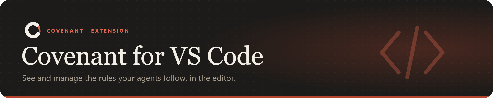

<p align="center"></p>

<p align="center">See and manage the rules <a href="https://github.com/visweshdev/Covenant">Covenant</a> enforces on coding agents, right in the editor. <a href="https://github.com/visweshdev/Covenant/blob/main/docs/README.md">Covenant docs</a></p>

---

## Get started

Use VS Code 1.100 or later and install Covenant in a Python 3.11+ environment the editor can
access.

```bash
python -m pip install covenant-agents
python -m covenant --version
```

1. Open a trusted Git repository folder and select **Covenant** in the Activity Bar.
   In a multi-root workspace, use **Switch Folder** to choose where to check or write rules.
2. Use **Select Python** if Covenant is installed in a virtual environment or pipx.
   The interpreter selection applies to the chosen folder.
3. Choose **Draft Rules** for your own instruction or **Guide → Starter prompts**.
   Edit a starter to fit your project. Review the generated YAML and its warnings,
   then choose **Write Rules** in the sidebar. You can reopen or discard the pending draft.
4. Select **Set Up Hooks** and choose Git only or Git with project-local Claude Code hooks.
   Choose **Start Task** if the hooks are already in place or you want to pin a baseline
   for editor checks only. Use the manual setup for existing Git hooks.
   [Git hook setup](https://github.com/visweshdev/Covenant/blob/main/docs/agents.md#git-hooks)

## Work in the sidebar

| Section | What you can do |
|---|---|
| **Overview** | See setup and approval status, recheck the working tree, run declared tests, jump to findings, and read recent task activity. |
| **Rules** | Search by rule ID, checker, description, or path. Use **Needs Review** to find current findings and rules that require human input. Expand a rule for its scope, assumptions, source, and block count. |
| **Guide** | Follow the setup steps, edit or copy one of four starter prompts, and copy MCP setup or an agent handoff. |

**Check Now** uses `covenant check --preview`. It leaves protected files in place and
keeps the agent's block count unchanged. Checks also refresh when you save, when
`covenant.yaml` changes, and when Covenant records activity. The status bar shows
the task state. Covenant puts findings in **Problems** and marks protected files in
the Explorer.

**Run Tests** uses the test commands declared in the rules and records the result.
**Add a Rule** previews an additional instruction and asks you to confirm before
updating the policy. Edit `covenant.yaml` directly for changes to existing rules,
then start a new task to approve the new policy.

## Use with a coding agent

- **Claude Code** can use the project-local hooks installed by **Set Up Hooks**.
- **VS Code / Copilot, Cursor, or Codex** can use **Copy MCP Setup** in **Guide**. Choose
  a client, then merge the snippet into the indicated config on the machine running
  the client. The snippet uses the selected Python executable and repository path.
  [VS Code configuration](https://code.visualstudio.com/docs/agents/reference/mcp-configuration) · [Cursor configuration](https://cursor.com/docs/mcp) · [Codex configuration](https://developers.openai.com/codex/mcp)
- **Any coding agent** can receive **Copy Agent Handoff** alongside your task. It asks
  the agent to read the approved rules, use Covenant's tools when available, and report
  the checks it actually ran.

MCP checks run when the agent calls the tools. Git hooks check Git operations regardless
of which agent issued them. [Covenant integration guide](https://github.com/visweshdev/Covenant/blob/main/docs/agents.md)

## Settings

| Setting | Default | What it does |
|---|---|---|
| `covenant.pythonPath` | `python` | Python executable with Covenant installed. **Select Python** can pick a workspace environment or browse to an executable. |
| `covenant.checkOnSave` | `true` | Recheck after saving a file in the selected workspace folder. |
| `covenant.offlineCompile` | `false` | When enabled, always compile locally. Otherwise, custom prompts let you choose local compilation or Claude. Starter prompts compile locally. |

## Build

Run these commands in `vscode-extension` with Node.js 22 or later.

```bash
npm ci
npm test
npm run package
```

Install the resulting VSIX using **Extensions: Install from VSIX…** in the Command
Palette. A VSIX is also attached to each [GitHub release](https://github.com/visweshdev/Covenant/releases).

With Covenant installed in the Python on your PATH, run `npm run test:e2e` to test against
VS Code 1.100.3 using a disposable repository and isolated profile. On headless Linux,
run `xvfb-run -a npm run test:e2e`. To run against a specific installed executable, run
`npm run compile` followed by `node out/test-e2e/run.js "/path/to/Code"`.
